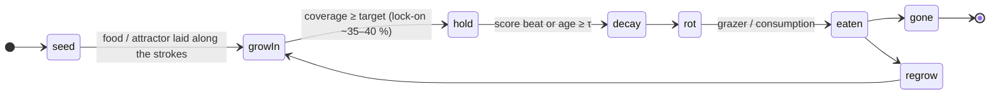
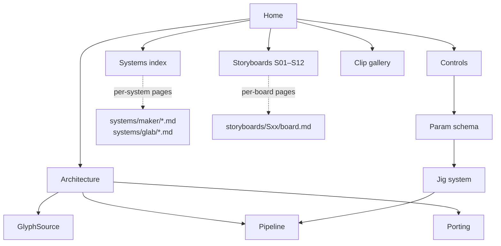

# Living type

> A reference for AJ's (Abhishek Jayaprakash) **living type** system: animated organisms and materials grow into typography, hold it legibly, then decay.

Living type is a type system in which **letters are not drawn: organisms and materials grow into them**. A word is laid out as food, a chemoattractant, a wall or a target shape. Colonies and materials (mycelium, *Physarum*, lichen, dividing cells, diatoms, roots, frost, gels) **grow into the type**, **hold** it as a readable word, and then **decay**, **dissolve** or **get eaten**. One knob, `legibility`, trades readability against life, and the whole frame goes through a **microscope look** (darkfield HUDDI by default) with a camera that can zoom, rack focus and shape the circle of confusion.

*The lifecycle per glyph region (`seed → growIn → hold → decay → rot → eaten → (gone | regrow)`). Different letters can sit in different states, so a word can cascade.*

## Where it runs

| Surface | Role | Status |
|---|---|---|
| **Swift/Metal on macOS** | The final implementation and the **master**. It extends an existing macOS Metal life layer (the "ink jig": `PaintSim+Life.swift` + `Shaders/`) through eight hooks, H1–H8, without forking it. | Planned; the hooks have not landed yet. `LifeKnobs` has `leak` but no `livingType` field yet. |
| **Jigs (macOS tool apps)** | Small single-purpose apps that tune one thing (a species, a glyph source, an optic, a rack, an arc) and write presets. The result is baked into the final UI/UX. | Designed here ([Jig system](jig-system.md)). |
| **iOS / iPadOS** | The same Metal code at lower tiers: **M5 full**, **A16 mid**, **A12 cheap**. | Follows the Mac port. |
| **Web (WebGPU)** | Built case by case only, from the same presets, for a specific page or demo. Never the master. | Not started. See [Porting](porting.md). |
| **Python CPU preview** | numpy / numba / scipy / PIL + ffmpeg. A look and behaviour spec and a reference renderer. Not shipping code. | About 70 distinct pieces rendered; see the [clip gallery](clips.md). |

## Map of this site

| Chapter | Read it for |
|---|---|
| [Architecture](architecture.md) | The macOS-first layer stack: **GlyphSource → Field products → Species sim (Metal compute) → Material/Look post-stack (optics) → Camera (zoom, rack, CoC) → Recorder/master**, the frame graph, and how each layer plugs into the ink jig through H1–H8. |
| [GlyphSource](glyph-source.md) | The replaceable glyph front end: fonts via CoreText (with variable axes), PencilKit or mouse strokes, SVG/Bézier paths and images, and every product the sims read (mask, SDF, skeleton, tangent field, counters, ids, outlines, metrics, layout). |
| [Pipeline](pipeline.md) | The macOS master pipeline: jig → bake → master render → phone and web copies, with the exact specs for each, and where the CPU preview fits. |
| [Porting](porting.md) | Python preview → Swift/Metal: what maps cleanly, fixed-step sim vs render rate, precision, determinism, device tiers, iOS notes and the case-by-case web (WebGPU/WGSL) policy. |
| [Controls](controls.md) | The shared control model: `legibility` (and `leak = 1 − legibility`), the default arc, time, seeds, species hero knobs, camera, look, HUDDI palette swatches and the M5 / A16 / A12 tiers. |
| [Param schema](param-schema.md) | A portable parameter schema as Codable Swift structs and JSON (Scene, Layer, Species, Look, Camera, Timeline, Preset) with units, ranges, defaults and animatable flags, plus worked JSON for *Trust the process* and *split*. |
| [Jig system](jig-system.md) | Jig types, shared infrastructure (registry, live binding, presets, A/B, curve record/replay, seeds, golden frames, a `?meter`-style perf HUD) and how tweaks bake into the final UI. |
| [Systems index](systems/README.md) | Every system, grouped (microscope looks/optics, organisms, goo/materials, branching, type behaviours), with links to the per-system pages. |
| [Storyboards](storyboards/README.md) | S01–S12, one board each, with status. |
| [Clip gallery](clips.md) | Every preview clip by name: word, font, system, look and AJ's reaction. Clips are referenced by name only; none are embedded. |

## The legibility knob in one paragraph

Every species takes `legibility` ∈ [0, 1] with `leak = 1 − legibility`. At 1.0 growth stays inside the strokes and the counters stay clean; at 0.0 it invades the counters and gaps and eats the letters. The **default arc** wanders at 0.2, locks on at 35–40 % of the clip, holds at 1.0 from 40–75 %, then eases to 0.35 ("filament script"). **Ink bleed** and **venation** run the reverse arc: the word starts crisp and the knob erodes it. Details: [Controls §1](controls.md).

## Status (19 Oct 2026, IST)

- **Preview corpus:** species, microscope looks, mitosis, goo G1–G6, variations V1–V8, Batch B branching B1–B6 (sent to AJ, no reaction yet) and Batch C C1–C6 (unseen). All 24 fps; most 1080×1080, *Trust the process* and *gravity always wins* 1080×1920.
- **AJ's favourites (LOVED):** mycelium spore heads ("most lovely so far"), fruiting *fruit*, Rheinberg Physarum 01a–c with focus tracking the front, bacteria *multiply*, *Trust the process*, V4 *SPLIT*, V5 *widow*, G1 *viscous*, and the round-blur CoC depth of field itself. **Dropped:** Vorticella *spring* and the Wavefont bar grid.
- **Shared systems in the preview:** the `legibility` knob (`visuals/maker/species/_common/legibility.py`), the ring-blur tilted CoC (`darkfield_huddi.ring_kernel` / `tilted_coc`, `_common/coc.py`), the darkfield HUDDI optics model (`darkfield_huddi.py`) and the phone encode (`_common/phone_copy.sh`).
- **Engine side:** the build plan (hooks H1–H8, milestones M0–M5) is written; no living-type Swift code exists yet. The Mac test bridge and the perf micro-benchmarks are drafts and have not run.
- **Refine-next order:** V5 widow → mycelium spore heads (arc + front-tracking CoC, branching `lifeHyphae`) → Rheinberg 01a–c as the first `MicroscopePass` → `msDefocus` → fruiting → G1 → mitosis/V4 → bacteria → the 👍 tier → C5/C6 → Batch B → Batch C rest.

## How to read this site

- **Real names first.** Code identifiers (`legibility_at`, `food_field`, `lifeHyphae`, `MicroscopePass`, `LifeKnobs.leak`) are quoted from the preview code or the build plan. Paths like `visuals/…` are relative to the living-type project root.
- **Markers.** **[est]** marks an estimate. **[proposal]** marks something this site proposes and AJ has not approved. **[verify]** and **⚠ unverified** mark facts this site could not confirm.
- **Internal notes.** The site summarises AJ's internal research notes (the build plan with hooks H1–H8, the reference library, the Mac test-bridge plan, the micro-photography look library, the species font cast and the Apple-GPU perf notes). They are cited for provenance only and are not published; where this site and a note disagree, the note wins until AJ rules. GPU timings from those notes are deliberately **not** reproduced here.
- **Third-party work** (Fluoddity, Jones's Physarum model, Tero et al.'s Tokyo-rail experiment, Runions' space colonisation, Reiter's snowflake CA, Growing NCA, Particle Lenia and others) is cited by name only; no third-party figures or captures are included.
- **Links are root-relative** (docsify `relativePath: false`): pages link as `systems/maker/<id>.md` and `storyboards/S01/board.md`; images inside a page are relative to that page.
- **CLI names** for the macOS ink jig are written generically as `ink-jig …`.

## Line references drift

Every `file:line` in this site points at the macOS ink jig as it was when the pages were written. Hook sites move between engine revisions (`LifeKnobs.leak` has already moved within `Knobs.swift`), so treat each one as **a pointer to re-verify**, not an address.
