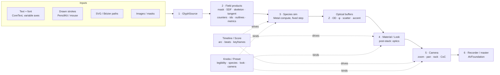
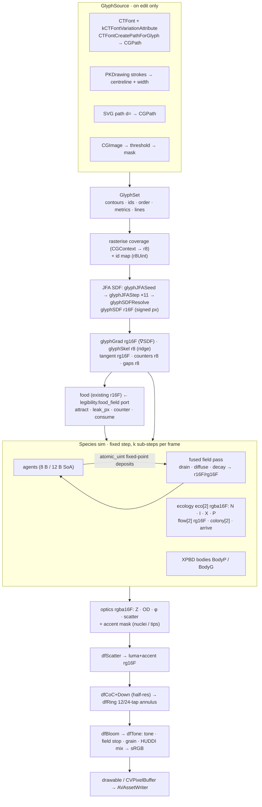
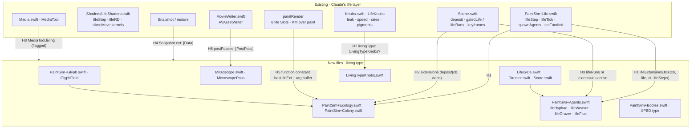

# Architecture (macOS first)

The master implementation is **Swift/Metal on macOS**, inside Claude's life layer in **the macOS ink jig**. Everything else (jigs, web builds, the Python preview) either feeds it presets or is derived from it. This chapter lays out the layers, the data that flows between them, one frame as a frame graph, and how each layer plugs into the macOS ink jig without forking it.

> Sources: AJ's internal build plan (life layer today, integration contract H1–H8, architecture, optics), the internal Apple-GPU perf notes (format rules, glyph geometry, darkfield model) and the clip inventory §0. Internal notes are cited for provenance only and are not published.

## 1. The six layers



| # | Layer | Owns | Writes | Engine home (planned) |
|---|---|---|---|---|
| 1 | **GlyphSource** | Turning *anything letter-shaped* into a laid-out set of contours with ids, order and metrics. Fonts are replaceable; glyphs can be drawn or come from paths. | `GlyphSet` (contours, per-glyph id, advance, baseline, line index) | `PaintCore/GlyphField.swift` / `PaintSim+Glyph.swift` (doc 42 §2.3, §6.1) |
| 2 | **Field products** | Rasterising and deriving everything a species can read, at sim resolution, cached until the text changes. | `glyphMask`, `glyphSDF` (r16F), `glyphGrad` (rg16F), `glyphSkel` (r8), `glyphId` (r8Uint), tangent field, counters, gaps, outline buffers | same; JFA kernels `glyphJFASeed/Step`, `glyphSDFResolve` (doc 42 §6.1) |
| 3 | **Species sim** | Growth, holding and decay: agents, grids, bodies, ecology. Fixed time step, deterministic per device. | species fields, agent buffers, ecology `eco/flow/colony/arrive`, the `optics` texture | existing `lifeStep`/`lifeRD`/`slimeMove` + new `PaintSim+Ecology/Colony/Agents/Bodies.swift` via **H1** |
| 4 | **Material / Look** | The optics post-stack: darkfield HUDDI (hero), Rheinberg, DIC, phase, fluorescence, polarised, stained brightfield, plus non-micro materials (gel, wax, mercury, stone, soil). | luma + accent (rg16F) or linear RGB | `Microscope.swift` (`MicroscopePass`) via **H6**; species compositing via **H5** `hasLifeExt` |
| 5 | **Camera** | World→screen transform (zoom, pan, rotation), focal plane (tilt, rack, tracking target) and the circle of confusion. Ring-bokeh DOF. | screen-space frame + CoC map | `msDefocus` inside `MicroscopePass`; camera transform before H6 (INVENTORY §3) |
| 6 | **Recorder / master** | Fixed-rate offline render, encode, stills, metadata. | master file (+ stills, sidecar JSON) | existing `MovieWriter.swift` (AVAssetWriter) |

Two cross-cutting services sit beside the layers:

- **Timeline / Score**: the arc (legibility over normalised time `u`), per-glyph lifecycle state, beats and knob keyframes. Planned as `Score.swift` + `Lifecycle.swift` + `Director.swift` (doc 42 §6.4–6.6).
- **Knobs / presets**: the parameter registry. In the engine it is `LifeKnobs` with an optional `livingType: LivingTypeKnobs?` (**H7**), `MicroscopeKnobs`, and a camera block; on disk it is the [param schema](param-schema.md).

## 2. Data flow and formats



**Format rules:** new trail fields are `r16Float`/`rg16Float`, never `rgba32Float` (quarter-rate sampling, and not filterable on A12–A16). Leave the existing fp32 lichen/growth fields alone. Agents shrink from the current 16 B `float4` to **8 B** (Jones/Physarum: `unorm16×2` position + packed `u32`) or **12 B SoA** (vector-trail: 8 B + `half2` velocity). Deposits stay **integer atomics** for determinism; no float atomics anywhere.

## 3. One frame as a frame graph

Each stage is its own compute encoder so it gets its own GPU timestamp (Apple GPUs sample counters at stage boundaries).

```mermaid
flowchart LR
  A0["① Score eval<br/>(CPU, chunk boundary)"] --> A1["② GlyphField update<br/>only if text/axis changed"]
  A1 --> A2["③ lifeStep / lifeTick<br/>existing kernels"]
  A2 --> A3["④ H1 lifeExtensions.tick ×k<br/>agents → fused field → ecology"]
  A3 --> A4["⑤ compaction + indirect args<br/>(ordered scan)"]
  A4 --> A5["⑥ lifeCoverage reduce → Director<br/>(fixed latency, 1 chunk)"]
  A5 --> A6["⑦ paintRender + H5 lifeComposite<br/>or living-type-only body pass"]
  A6 --> A7["⑧ H6 PostPass: MicroscopePass<br/>scatter · DOF · bloom · tone · grain"]
  A7 --> A8["⑨ present (MTKView)<br/>or Recorder (offline)"]
```



| Stage | Cadence | Budget |
|---|---|---|
| Agent sim (k sub-steps) | every frame, k = 2–4 | the largest share; bandwidth-bound |
| Field (fused) | per sub-step | |
| Glyph + ecology + director | ecology every 2–4 frames at half res; glyph on edit | small |
| Body render | every frame | |
| Darkfield optics | every frame | by tier (full / mid / cheap) |
| Composite (+ over paint) | every frame | small |
| Present | every frame | small |
| **Sum** | | must fit 16.67 ms (60 fps) or 8.33 ms (120 Hz stretch) |

At the 120 Hz stretch, M5 drops to the mid optics tier and fewer agents. Per-stage milliseconds are deliberately not quoted here: they come from the perf HUD and the Mac perf jobs (drafts, not yet run). ⚠ unverified until measured on device.

### Live vs offline

| | Live (jig, performance) | Offline (master) |
|---|---|---|
| Clock | display-linked, adaptive step budget (`PERFORMANCE.md` #4 slows sim time on overrun) | fixed `dt`, fixed steps per output frame, never drops |
| Optics tier | per device (full / mid / cheap) | always **full** (the M5 tier), optionally supersampled |
| Readbacks | fixed latency (one chunk = 32 steps) | same, so offline and live replays agree |
| Output | `MTKView` drawable | `CVPixelBuffer` pool → `AVAssetWriterInputPixelBufferAdaptor` |

## 4. How it plugs into the macOS ink jig

The contract in doc 42 §2.3: **new code in new files only**, Claude's kernels untouched (`lifeStep`, `lifeRD`, `slimeMove`, `bakeDry`, `paintDeposit`, `paintRender`), new shaders in their own raw strings and `MTLLibrary`, everything behind `PaintSim.livingType` (default **false**) and `LifeKnobs.livingType == nil`, and a golden parity check with the flag off.



| Hook | Where (per doc 42; re-verify at tip) | Living-type layer it serves |
|---|---|---|
| **H1** `lifeExtensions` | end of `lifeTick` (the `e.endEncoding()`), or right after `lifeStep` returns | Species sim: new species tick on the same tick and RNG index (`lifeSteps`) |
| **H2** deposit forwarding | `Scene.swift`, right after `sim.deposit(cb, study.dabs[s..<e], …)` | Brushes and seeds (`Seed` ≥ 10) for new species; `paintDeposit` already ignores unknown seeds |
| **H3** gating | `Scene.swift` `lifeRuns` | New species wake the life tick |
| **H4** snapshot | `PaintSim` `Snapshot / snapshot / restore` | Undo, keyframes and replay cover new state |
| **H5** render | `paintRender`, function constant `hasLifeExt` (like `hwFilter`) | KM-correct compositing of new species (`lifeComposite`) without breaking the 8-slot layout |
| **H6** post | render callers (`Scene`, InkPad, `MovieWriter` loop) | Look post-stack + camera DOF (`MicroscopePass`) |
| **H7** knobs | `LifeKnobs` | `legibility` and every living-type knob, Codable-compatible (old scenes decode) |
| **H8** tools | `Media.swift` | Ink Pad bar tools behind a flag |

### Legibility at the seam

The preview's `legibility` maps straight onto what exists: `LifeKnobs.leak` ("how far growth creeps past the food") **becomes `1 − legibility`** for the existing moss/lichen/hyphae paths, written per lifecycle state through H7, while the new kernels read `attract / counter / consume` directly (INVENTORY §0.1). Render-side, the "snap to readable" at the hold beat is `B' = mix(B, B·Tg + rim·edge(SDF), ℓ_render)` with `ℓ_render ≤ 0.6` (doc 42 §6.5). See [Controls](controls.md).

### Two operating modes

1. **Over the paint core**: living type composites over Claude's paint render. Use cached or dried paint at 120 Hz; live paint leaves almost no headroom.
2. **Living type alone**: its own mode; the paint core is off or a cached texture. This is the default for mastered clips.

## 5. Module layout (Swift package view) [proposal]

```text
InkJig/Sources/
  PaintCore/
    PaintSim+Life.swift          (existing driver; H1/H3/H4 hook points)
    Shaders/LifeShaders.swift    (existing kernels, byte-identical)
    Shaders/GlabShaders.swift    (new: ecology, agents, bodies, glyph JFA)
    PaintSim+Glyph.swift         GlyphField: GlyphSource → field products
    PaintSim+Ecology.swift       eco/flow/colony/arrive/optics textures
    PaintSim+Colony.swift        lifeColony
    PaintSim+Agents.swift        lifeHyphae (kind 4), lifeWeaver, lifeGrazer, lifeFluo
    PaintSim+Bodies.swift        XPBD type bodies, lifeBodySplat
    Microscope.swift             MicroscopePass (tiers via function constants)
    Lifecycle.swift  Director.swift  Score.swift
    LivingTypeKnobs.swift        H7 payload (Codable)
  LivingTypeKit/                 [proposal] Scene/Layer/Species/Look/Camera/Timeline/Preset schema,
                                 GlyphSource protocol + adapters, ParamRegistry, Recorder
  Jigs/                          [proposal] one executable target per jig (see Jig system)
```

`LivingTypeKit` is a proposal: a thin, engine-agnostic module so jigs, the master renderer and a future WebGPU exporter share one schema. It depends on nothing in PaintCore; PaintCore depends on it only through `LivingTypeKnobs`.

## 6. Determinism (per device)

- RNG keyed to `(id, lifeSteps, salt)` via `hash21`, never thread index or slot.
- Fixed-point `atomic_uint` deposits; no float atomics.
- Child agents get reserved slots (`parentIndex·K + childOrdinal`) or an **ordered** prefix-sum compaction (`lifeCompact`); never `atomic_fetch_add` order.
- Director readbacks at a fixed latency of one chunk.
- All interaction is dabs or score events with sim-time stamps; snapshots include all new state (H4).
- Goldens per device family (keyed like `m5-macos26-xcode26-v1`); across families compare perceptually only.

## 7. Risks carried into the design

| Risk | Mitigation |
|---|---|
| Texture-slot pressure in `paintRender` (already 18 textures) | `lifeComposite` second pass (portable to A12; argument buffers tier 2 is Apple6+) |
| fp16 stalling growth (seen with lichen) | keep `B` and arrival time `T` in fp32 if fronts stall; half only for trails |
| Legibility vs organic | Director PI gains clamped; golden at the hold beat with IoU vs `Tg` ≥ 0.8 |
| Optics hiding sim flaws | judge every species with optics off as well (doc 42 §9 risk 6) |
| Line refs drifting | hook sites move between engine revisions; re-verify every `file:line` before integrating |
