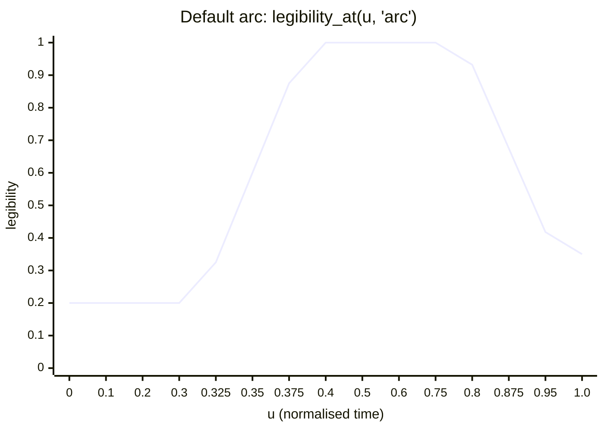

# Shared control model

Every species, look and camera exposes its own parameters, but a performer or designer should only ever need a **small shared vocabulary**: one legibility knob, time and the arc, a seed, three to six hero knobs per species, the camera, the look, the palette and the device tier. This chapter defines that vocabulary. The [param schema](param-schema.md) gives it a portable form, and the [jig system](jig-system.md) gives it controls.

> Sources: `visuals/maker/species/_common/legibility.py`; `visuals/glab/src/physarum_word.py` (`legibility_at`, `run`); `visuals/glab/src/ink_bleed.py` (`leg_rev`); `visuals/glab/src/looks.py`; `visuals/glab/src/darkfield_huddi.py`; `visuals/mitosis/mitosis.py`; INVENTORY §0; the internal build plan §6.4–6.6, §7.3.

## 1. The legibility knob

**One knob, `legibility` ∈ [0, 1]**, with the alias **`leak = 1 − legibility`**. The name and the alias were chosen to fit the life layer: `LifeKnobs.leak` is "how far growth creeps past the food" (default `0.15` in the engine at the time of writing), and the build plan says leak "becomes (1 − legibility)".

- **1.0**: growth stays inside the strokes; counters and gaps stay clean; the word is crisp.
- **0.0**: growth invades counters and gaps and eats the strokes; the word dissolves into the organism.

### 1.1 What it drives (`legibility.params(l)`)

With `k = 1 − l`:

| Term | Formula | Meaning |
|---|---|---|
| `attract` | `0.55 + 0.45·l` | mask attraction strength: food inside the strokes |
| `leak_px` | `8 + 46·k^1.3` | overflow allowance: width (sim px) of the food shoulder outside the glyph, so growth can bridge gaps between letters |
| `counter` | `0.55·l − 0.65·k` | counter term: **> 0 repels** growth from enclosed counters, **< 0 lures** it in |
| `consume` | `k` | how much the growth eats the letter substrate it sits on |
| `margin` | `1 + 3·k` | extra edge margin (px); returned by `params` but not described in INVENTORY [verify use per species] |

Values at the settings the clips actually use:

| `legibility` | `leak` | `attract` | `leak_px` | `counter` | `consume` | `margin` |
|---|---|---|---|---|---|---|
| 0.00 | 1.00 | 0.550 | 54.0 | −0.650 | 1.00 | 4.00 |
| 0.15 | 0.85 | 0.618 | 45.2 | −0.470 | 0.85 | 3.55 |
| 0.20 (arc wander) | 0.80 | 0.640 | 42.4 | −0.410 | 0.80 | 3.40 |
| 0.35 (arc end) | 0.65 | 0.708 | 34.3 | −0.230 | 0.65 | 2.95 |
| 0.50 | 0.50 | 0.775 | 26.7 | −0.050 | 0.50 | 2.50 |
| 0.80 (new-piece default) | 0.20 | 0.910 | 13.7 | +0.310 | 0.20 | 1.60 |
| 0.85 (mitosis, V4, V5) | 0.15 | 0.933 | 11.9 | +0.370 | 0.15 | 1.45 |
| 1.00 (arc hold) | 0.00 | 1.000 | 8.0 | +0.550 | 0.00 | 1.00 |

The counter term changes sign at `l ≈ 0.54`: above it counters repel, below it they bait.

### 1.2 The helpers

| Helper | Signature | What it returns |
|---|---|---|
| `food_field` | `(mask, sd, legibility)` | nutrient/attractor field (0..1+, can go negative = repellent): `attract·clip(0.5 − sd/leak_px, 0, 1)`, minus `counter·blur(counters, 3)` outside the stroke, plus gap bait `0.35·(1 − l)·blur(gaps, 6)·exp(−sd/60)` |
| `consumed` | `(substrate, growth_density, legibility, gblur)` | letter substrate left after eating: `substrate·(1 − clip(gblur(growth, 5)·2.2·consume))` |
| `tissue_sd` | `(sd, legibility, counters_soft=None)` | for body-shaped species (planarian, hydra, V4 split): tissue SDF swells past the outline (`sd − 18·k²`) and creeps into counters (`− 45·k^1.5·counters_soft`) |
| `counters_soft` | `(sd_letter)` | Gaussian-softened (σ 4) counter mask |
| `regions` | `(mask)` | cached `(counters, gaps)`: counters = `fill_holes(m) & ~m`; gaps = word bbox minus filled glyphs |

### 1.3 The default arc

`physarum_word.legibility_at(u, "arc")`, AJ 2026-10-17. `u` is normalised clip time (0 → 1).

| Phase | `u` | `legibility` | What you see |
|---|---|---|---|
| **Wander** | 0 – 0.30 | **0.20** constant | the organism explores; letters only smell |
| **Lock-on** | 0.30 – 0.40 | `0.2 + 0.8·smoothstep((u − 0.30)/0.10)` → 0.6 at 35 %, 1.0 at 40 % | growth snaps onto the strokes |
| **Hold** | 0.40 – 0.75 | **1.0** | clearly readable |
| **Ease out** | 0.75 – 1.0 | `1.0 − 0.65·smoothstep((u − 0.75)/0.25)` → **0.35** | "filament script": the word loosens into the organism |

Other accepted values: `"sweep"` (1.0 to 55 %, then `1 − 0.9·sin²(π·w)` down and back up), any constant, or env `LEGIBILITY`. The default constant on new pieces is **0.8** (logged per row in the word/font registry). Clips with fixed values: mitosis, V4 and V5 at 0.85, tardigrade 0.85, planarian/hydra/vorticella 0.8, B1–B6 and C1–C6 0.80; the amoeba animates 1.0 → 0.1; mycelium *LIGATURE* animates 1.0 → 0.0 (the knob's golden reference).

In `physarum_word.run`, the arc drives more than the food field: `fw_far = 0.15 + 0.45·L` (how far letters pull from), `fw_near = 0.15 + 2.2·L` (lock strength), heading noise `0.08 + 0.30·(1 − L)` (wander rises as legibility drops), on-stroke speed `1 − 0.75·L·onl` (linger), deposit weight `1 + DEPL·L·onl` (denser trail on strokes), and starvation of off-letter agents `0.004 + STARVE·L` after 36 %.

### 1.4 Reverse use: legibility as erosion

The same knob run backwards is a decay arc. Three families use it that way:

| Use | Example | How |
|---|---|---|
| **Bleed** | V1 *bleed* (`ink_bleed.leg_rev`) | reversed arc: `1 − 0.85·smoothstep((u − 0.45)/0.55)` → 1.0 to 45 %, **0.926** at 55 % (the code comment says "≈0.8" [verify]), 0.52 at 75 %, **0.15** at the end. Physarum agents leave the letters along a fibre field. Next step in INVENTORY: end at L ≈ 0 so consumption finishes the word. |
| **Venation / skeletonising** | B3 *venation* | marginal vein strength = legibility; the lamina browns and dissolves areoles-first, so lowering legibility exposes the vein skeleton |
| **Less is more** | V2 *brittle* (next step), B5 *crystal* ice gate, C4 *kernel panic* crash | coverage tied to `1 − l` so the material **removes** the word: frost erodes it (V2), the ice gate opens at `1 − legibility` (B5), Life-CA letter bias gated by `smoothstep((arc − 0.3)/0.6)` (C4) |

Storyboard S11 *Less is more* is the natural home for the reverse arc.

### 1.5 Port

H7 adds `LifeKnobs.livingType: LivingTypeKnobs?` carrying `legibility`. Per lifecycle state (doc 42 §6.4) it writes `leak = 1 − legibility` for the existing moss/lichen/hyphae paths and `attract / counter / consume` for the new kernels. In-sim (doc 42 §6.5): growth `×= mix(1, Tg, ℓ)`, decay outside `×= mix(1, 1 + 4(1 − Tg), ℓ)`, attract `∝ ℓ`. Render-side snap: `B' = mix(B, B·Tg + rim·edge(SDF), ℓ_render)` with **`ℓ_render ≤ 0.6`**. Body-level (XPBD type): `β = mix(0.9, 0.05, life)`, `life` being the body's own "legibility vs life" slider.

**Not wired yet** (INVENTORY §0.1): coral, ephyra, radiolarian, siphonophore, sponge, fruiting, the two mycelium spore clips, letter-creatures, physarum_type, ferro and the maker goo G2–G4 have no knob.

## 2. Time and the arc

| Control | Type | Notes |
|---|---|---|
| `duration` | seconds | preview clips are 6–10 s; mitosis 22 s; mycelium 15 s variant |
| `fps` (output) | 24 (preview), 24/30/60 (master) | all preview clips are 24 fps |
| `simRate` | steps per second of film time | fixed; independent of output fps (see [Porting](porting.md) §3) |
| `u` | 0..1 | normalised clip time; every arc is a function of `u` |
| `timeScale` per lifecycle state | 1–16× | maps to `LifeKnobs.speed` ("ageing: life steps per tick"); rot runs at 4–8× (doc 42 §2.1) |
| `arc` | curve id or keyframes | `arc` (default), `sweep`, `reverse` (`leg_rev`), constant, or a keyframed curve |
| `beats` | `[t]` | Score events (doc 42 §6.7): `ScoreEvent(t, glyph or all, state or knob, value, ease)` from JSON or a beat list; no live audio inside the sim |
| `unlock[]` | per-glyph start times | mitosis `UNLOCK = [0.0, 5.6, 6.2, …, 12.3]` (15 letters); V4 `[0.0]·5` |

Lifecycle states (doc 42 §6.4) map onto the arc: **wander ≈ seed/growIn**, **lock-on ≈ growIn → hold**, **hold**, **ease-out ≈ decay → rot**; **eaten/gone/regrow** are per-species extensions.

## 3. Seeds

- One **scene seed** (u64) plus a **salt per layer/species**. All randomness derives from `hash21(id, lifeSteps, salt)` or `SplitMix(seed ^ salt)` (doc 42 §2.3 rule 4).
- Preview seeds to carry over as provenance: mitosis `default_rng(23)` (sim), `default_rng(99)` (cell sizes/strays), `default_rng(77)` (floaters), per-frame grain `default_rng(10000 + i)`; looks `default_rng(7)` (granules/dust), grain `default_rng(3000 + i)`; `physarum_word.run(seed=1)`. **numpy streams will not reproduce on the GPU**; the port re-seeds with `hash21` and the golden frames are re-blessed from the Metal render.
- A preset stores the seed; a jig "reroll" changes only the seed, never the knobs, so A/B is fair.

## 4. Species hero knobs

Three to six knobs per species that a performer should touch; everything else stays in the species jig. Hero knobs are marked `hero: true` in the [schema](param-schema.md). The per-system pages (written separately) are the authority; the examples here are taken from the code.

| Species / system | Hero knobs (real names) | Source |
|---|---|---|
| Physarum word (Jones agents) | `GROW` (stroke thickening, 1.2–1.8), `TRACK` (em, 0.04–0.08), `DEPL` (deposit on strokes, default 3.0; C5 5.5), `STARVE` (off-letter death, default 0.022; C5 0.045), `n_max` (220 000), sensor angle `SA` 30° / turn `RA` 40° / offset `SO` 9 | `physarum_word.py` |
| Existing slime (engine) | `slimeSensor`, `slimeAngle`, `slimeTurn`, `slimeSpeed`, `slimeDecay`, `slimeDiffuse`, `slimeFood` | `LifeKnobs` (doc 42 §2.1) |
| Mycelium / hyphae | `fungusRate`, `fungusWander`; new `lifeHyphae`: branch threshold θ, branch chance, branch angle (60–90°), `KINK` (heading kinks, B2 N(0, 0.14)) | `LifeKnobs`; doc 42 §6.3; B2 |
| Mitosis cells | `RF` (cell radius, 7.5 / V4 9.0), `LEG`, `GAPK` (V4 0.46), `UNLOCK[]`, `T_REL` (zona release, 3.95 s / V4 −1) | `mitosis.py`, `split_mitosis.py` |
| Knot-weaver | `knotLoop` (= b·ω, "how knotted"), `knotOmega`, `knotAmp`, `branchThreshold` θ_T, `branchChance` pT | doc 42 §6.3 A |
| Colony | per species `rate`, `ringPeriod`, `ringAmp`, `lifespan`, `sporeRate` | doc 42 M2 `ColonyKnobs` |
| Frost (B5) | Reiter `α` 1.0, `β` 0.40, `γ` 1e-4, ice gate (`1 − legibility`) | INVENTORY §6 |
| Gel bodies | stiffness 0.10–0.35, damping 0.80–0.86, pressure 0.2–0.6 | doc 49 §2 |
| XPBD type | `life`, `crawlAmp`, `swimAmp`, `podRate`, `slotK` | doc 42 §6.10 |

## 5. Camera

| Control | Unit | Notes / preview precedent |
|---|---|---|
| `zoom` | × (log-interpolated) | mitosis `CAM_K` 12.5 → 12.0 → 10.2 → 6.2 → 3.0 → 1.9 → 1.5 → 1.28 → 1.0 → 0.965, PCHIP in log space |
| `centre` | world px or a named target | targets resolved from the layout: `E` (embryo), `T`, `W` (first word), `B` (whole block), blends `ET`, `TW`, `WB` |
| `focus` (focal plane) | normalised y (or world y/x) | `tilted_coc` `focus` 0..1; mitosis keys a world-y target, V4 keys world-x |
| `tilt` | (tx, ty), normalised | Scheimpflug plane `focus + tx·(x/W − 0.5) + ty·(y/H − 0.5)`; looks rack tilt `0.55 − 0.85·w` |
| `maxr` | px at 1600 wide | max CoC radius; looks 12–24, C1 11, C2 7, mitosis clamp 30 |
| `globalDefocus` | px | mitosis opens at 9 px defocus and pulls in by 1.1 s |
| `track` | `none` / `front` / `nucleus` / `target` | `coc_track`: focus follows the growth-front peak (falls back to the seed nucleus), σ 0.9 s temporal smoothing, slew ≤ 6 px/frame. **AJ LOVED** this (01a–c). |
| `ringInner` | 0..1 | annulus inner ratio 0.62 (ring bokeh); DIC uses 0.45 |
| `dofLevels` | int | preview lerps 7–8 ring-kernel blur levels |

## 6. Look

| Control | Notes |
|---|---|
| `mode` | `darkfield` (hero, D1), `rheinberg`, `dic`, `phase`, `fluorescence`, `polarised`, `brightfield`, `brightfieldStained`, plus materials: `gel`, `wax`, `mercury`, `stone`, `soil`, `paper`, `deepSea` |
| `tier` | `full` / `mid` / `cheap` (see §8) |
| darkfield model knobs (`darkfield_huddi.py`) | `kappa` (φ = κ·Z), ring dirs `K` (0 closed form / 4 / 8), `ringBias` b (0–0.5, decentring), `ringAngle` θ₀, `se`/`c` soft-compress (14 / 0.9), ridge `sr`, granule `sg`, volume `sv` (0.01), Airy skirt `h` (0.25), bloom threshold 0.55 / gain 0.35, tone `k` (`1 − e^{−kI}`; mitosis 1.6), grain photons `N` (160–320) and read noise σ_r (0.0035–0.008) |
| Rheinberg | `stop` colour + annulus `c1`/`c2` split by edge azimuth (`sin(θ − 0.4) ≥ 0`) |
| fluorescence | `cg`, `expo`, `gg`, `fill`, `knock`, photobleach 18 % |
| polarised | polariser angle sweep, `gscale` (retardance scale) |
| field | field stop (`stop(r) = clamp((1 − r)/0.05)·(1 − 0.35·r²)`), vignette, dust, stage drift |
| `wipe` | V8-style filter-turret wipe between modes (`SPEC_TC = 0.27, 0.55, 0.80`, half-width 0.045) |

## 7. Palette swatches

### 7.1 HUDDI (hero)

| Swatch | Hex | Rule |
|---|---|---|
| `bg` | `#0d0d0d` | background |
| `ink` | `#e8e8e8` | scattered light / body |
| `green` | `#33ff66` | **only** on nuclei and growth tips (also contractile vacuole, eyespots, spasmoneme flash, leader tips where noted). Never tints the frame. |
| `cream` | `#f5e6a8` | body tints, heater glow, halos |
| `hi` | `#00ff88` | highlight accent (`ACC_HI` in mitosis) |
| `warn` | `#ff8800` | warnings (HUD), crash states |
| `mid` | `#666666` | mid grey, labels, rails |

Mix rule (as coded in `looks.accent_mix` / `darkfield_huddi.py`): in linear light, `C = mix(bg, ink, L′)`; accent `α = clamp(1.3·A·(0.55 + 1.2·L′))`; `C = mix(C, green·(0.5 + 0.8·L′), α)`; then encode sRGB. The Metal port keeps the same rule.

### 7.2 Labelled non-HUDDI palettes ("real-ish")

Real-ish materials may use other palettes; the clip label must say so (the preview labels them "real-ish colour").

| Palette | Colours | Used by |
|---|---|---|
| Rheinberg deep blue | stop `#1c4a66`, cream `#f5e6a8`, rose `#e8707e` | 01a *membrane* |
| Rheinberg teal + amber | stop `#1f5c5a`, `#f2a43a`, `#c9741f` | 01b *cytoplasm* |
| Rheinberg HUDDI | stop `#0d0d0d`×2.2, cream, cream×0.55 | 01c *gradient* (hero-palette variant) |
| Rheinberg violet/amber | stop `#3d1166`, `#ffb547`, `#e0812e` | C5 *grain* (tip accent should go amber, INVENTORY) |
| Rheinberg teal (vines) | stop `#1d5a5e`, cream, `#b9e6cf` | B4 *tendril* |
| Fluorescence (V4) | bg `#040406`, membrane `#ff3d8b`, DNA `#3fd0ff`, cytoplasm `#7a2a8a`, hi `#e8f6ff` | V4 *SPLIT* |
| Michel-Lévy LUT | computed (24 λ, CIE fits) | look 05, diatoms 06, B5 |
| Lichen (engine) | `lichenEdge #E39A2B`, `lichenCore #8E9A7B` | existing lichen |
| Weaver (engine plan) | `weaverCore #6E77C8`, `weaverKnot #EDE3C8` | knot-weaver |
| Hyphae (engine) | `#F1ECDD` | existing fungus |
| Microscope palettes | `palettes.json`: agar, brightfield, brightfield-stain, cryoem, darkfield, dic, fluorescence, macro, phase, polarised, sem, tem | doc 47 |

## 8. Tiers

Feature sets per tier, as coded in the preview optics (`darkfield_huddi.py`, `looks.py`). Device mapping: **M5 = full**, **A16 = mid**, **A12 = cheap**.

| | **Full** (M5 @ 60) | **Mid** (A16 @ 60; M5 @ 120) | **Cheap** (A12-class; A16 @ 120) |
|---|---|---|---|
| φ/Z resolution | full | full | half |
| Edge scatter | K = 8 ring × 2 scales | K = 4 ring | closed form, iso + 1 direction |
| Ridge glow | 3×3 Laplacian | 3×3 Laplacian | – |
| Airy skirt / dust | ✓ / ✓ | – | – |
| DOF | half-res 24-tap annulus, near/far | half-res 12-tap annulus | 3-level Gaussian mip lerp |
| Bloom | 3 levels | 2 levels | – |
| Grain | hash Poisson–Gaussian | hash Poisson–Gaussian | precomputed texture, scrolled |
| Agents / sim field | largest | reduced | smallest; buffer atomics only (A12 has no texture atomics) |

Rules: 60 fps everywhere; 120 Hz is a stretch goal on M5 and ProMotion iPhones only. Agent counts, field resolution and per-pass milliseconds per tier are set from on-device measurement and are not quoted here (⚠ unverified until the Mac perf jobs run). When a tier drops, **sim and field shrink first** (bandwidth-bound), optics drop a tier second. Masters always render at full.
