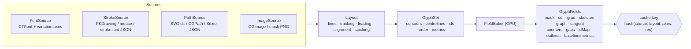
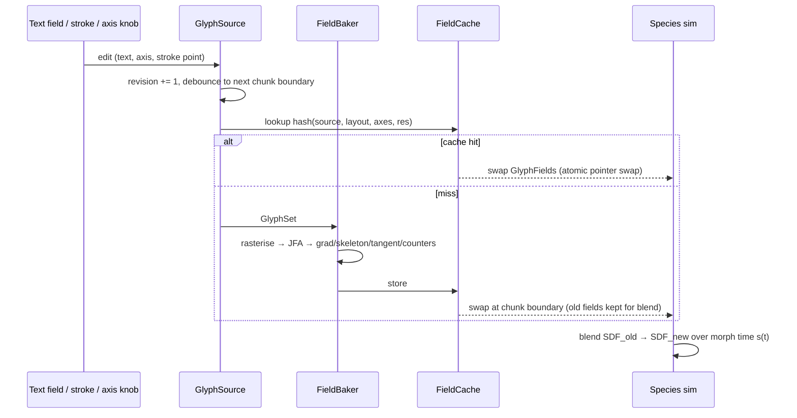

# GlyphSource

**GlyphSource** is the front end of the system: it turns *anything letter-shaped* into a laid-out set of contours and then into the field products every species reads. Its job is to make the font **replaceable** and to let glyphs be **drawn** or come from **paths** and **images**, without any species knowing which.

> Sources: doc 42 §6.1 (`GlyphField`: CoreText → coverage → JFA SDF, ∇SDF, skeleton, per-glyph id; morph by SDF blend), §6.7 (typing live), §6.10 (contour resampling for bodies); doc 49 §2–3 (variable-font gel skins, axis tags, COLR and stroke fonts); the internal perf notes (MSDF / Slug / variable fonts); the preview helpers `legibility.regions`, `food_field`, `tissue_sd`, `counters_soft`, `_common/labkit.py` (mask, SDF, skeleton) and the layouts in `mitosis.layout()` and `physarum_word.word_mask()`.

## 1. Shape of the API



```swift
/// Anything that can produce laid-out glyph geometry. [proposal]
public protocol GlyphSource {
    var id: String { get }                       // stable, used in cache keys and presets
    var kind: GlyphSourceKind { get }            // .font, .stroke, .path, .image
    /// Geometry in layout space (points, y-down, origin top-left of the layout box).
    func glyphSet(layout: TextLayout, at time: Double) throws -> GlyphSet
    /// True if the output can change over time (animated axis, live stroke, live text).
    var isAnimated: Bool { get }
}

public enum GlyphSourceKind: String, Codable { case font, stroke, path, image }

public struct GlyphSet {
    public var glyphs: [Glyph]                   // reading order
    public var lines: [LineMetrics]              // baseline, ascent, descent, x-height, cap height per line
    public var bounds: CGRect
    public var revision: UInt64                  // bumps whenever geometry changes
}

public struct Glyph {
    public var id: UInt16                        // 1-based, unique per GlyphSet; 0 = background
    public var order: Int                        // reading order (line-major, then x), drives cascades/unlocks
    public var line: Int
    public var character: Character?             // nil for drawn/path glyphs with no text mapping
    public var contours: [Contour]               // closed outlines, winding preserved (counters stay holes)
    public var centreline: [Polyline]?           // native for strokes; derived from skeleton otherwise
    public var strokeWidth: Float?               // for stroke sources (pressure-modulated per point if present)
    public var advance: CGFloat
    public var origin: CGPoint                   // pen position on the baseline
    public var bbox: CGRect
}
```

The species never see `GlyphSource`; they see **`GlyphFields`** (textures + buffers). That is what makes the source swappable.

## 2. Inputs

### 2.1 Fonts via CoreText (with variable axes)

Path per doc 42 §6.1 and doc 49 §3:

```text
CTFontDescriptor + kCTFontVariationAttribute {'wght': 680, 'opsz': 32, …}
  → CTFontCreateWithFontDescriptor
  → CTLineCreateWithAttributedString (kerning, ligatures, tracking via kCTKernAttributeName)
  → CTLineGetGlyphRuns → CTRunGetGlyphs + CTRunGetPositions
  → CTFontCreatePathForGlyph(font, glyph, &transform) → CGPath per glyph
  → CGPath.applyWithBlock: flatten quads/cubics → contours
```

- **Registration:** bundled fonts are registered with `CTFontManagerCreateFontDescriptorsFromData` (the ink jig already bundles Jost as a variable font). The preview's OFL fonts live in `visuals/fontcast/fonts/` with `*-OFL.txt`; Inter is in `visuals/mitosis/fonts/`.
- **Axes:** tags are 4-char codes packed into a 32-bit int (`'wght'` = `0x77676874`). Registered axes (`wght`, `wdth`, `opsz`, `slnt`, `ital`) and custom ones (`SOFT`, `WONK`, `MONO`, `CASL`, `ROND`, `YEAR`, `BNCE`, `INFM`, `ELSH`, `MORF`) work the same way. The preview uses many: Inter `wght 680 opsz 32`, Archivo `wdth 125 wght 800`, Fraunces `SOFT100 WONK1`, Recursive `MONO0 CASL0 wght700`, Doto `ROND100 wght700`, Climate Crisis `YEAR` (as hydration in *tardigrade BOLD*).
- **Animated axes:** don't call CoreText per glyph per frame. Variable-font interpolation is piecewise linear in normalised axis space, so pre-extract outlines at the default and each axis min/max (plus intermediate masters), resample with the same point count per contour, and **blend target buffers on the GPU**: `T = T₀ + Σₐ wₐ(loc)·ΔTₐ` (doc 49 §3). Contour count and start point are invariant across a variable font's design space, which is what makes this work.
- **Field rebake under animation:** the SDF and skeleton follow animated axes by (a) rebaking on "big" changes only, or (b) **blending baked SDF steps** (decision: MSDF atlases baked offline per font, weight step and alphabet; `wght` animation blends baked steps). The membrane (if used) follows the Bézier points continuously.
- **COLR fonts** (Honk, Nabla, Bungee Spice): `CTFontCreatePathForGlyph` returns the base glyph, which may be empty for COLRv1. Use the layer glyph ids, or render through CoreText to a texture and treat that as a **skin**, not the sim boundary (doc 49 §3).

### 2.2 Hand-drawn strokes (PencilKit or mouse)

Drawn glyphs are first-class, not a fallback.

| Step | Detail |
|---|---|
| Capture | `PKCanvasView` → `PKDrawing.strokes` → `PKStroke.path` (`PKStrokePoint`: location, timeOffset, size, force, azimuth, altitude). Mouse/trackpad: `NSEvent` points with pressure where available (Force Touch), the same struct with `force = 1`. the macOS ink jig already reads tablet pressure/tilt in `InkPad/PaperView.swift`. |
| Centreline | Native: the stroke points are the centreline. Resample by arc length (spacing ≈ 1–2 sim px), smooth with a light Catmull–Rom, keep `timeOffset` as a **draw-order parameter** (species can reveal along it, as C2 *hairline* does with "nearest spine time"). |
| Width | `size × force` per point → a variable-width tube. Outline = offset curves with round caps; or skip the outline and rasterise capsules straight into the mask. |
| Glyph grouping | Strokes become glyphs by (a) explicit grouping in the glyph jig, (b) time gaps > 0.6 s, or (c) bbox overlap. Each group gets a `Glyph.id` and `order` = first-stroke time. `character` is nil unless the user labels it. |
| Stroke fonts | EMS Casual Hand and Hershey are single-line fonts with no CoreText path: ship polylines as JSON → spine buffer → the same stroke path (doc 49 §3). The preview's *single-line* Physarum and letter-creatures clips use EMS Casual Hand. |

### 2.3 SVG and Bézier paths

- **SVG:** parse `<path d="…">` (M/L/H/V/C/S/Q/T/A/Z, absolute and relative; arcs converted to cubics), `<polygon>`, `<rect>`, `<circle>`; apply `transform`; respect `fill-rule` (nonzero vs evenodd) so counters stay holes. Each top-level `<g>` or `id` becomes a glyph; `data-order` sets order.
- **Bézier JSON** (portable, for presets and web): `{"contours":[{"closed":true,"segments":[["M",x,y],["C",x1,y1,x2,y2,x,y],…]}]}` per glyph.
- **Stroked paths** (open paths with `stroke-width`) go through the stroke route (centreline native, width from stroke).

### 2.4 Images

- Input: `CGImage` (PNG with alpha, or luminance). Threshold (Otsu or a set level) → mask; `id` by connected components (`label`, like `mitosis.layout()` does with `nd.label` then sorts by line and x).
- Contours via marching squares on the thresholded mask; centreline via the SDF ridge.
- Use for logotypes, scanned lettering and anything already raster. Images lose exact outlines, so the bake runs at ≥ 2× sim resolution and box-filters down (the preview does the same: `SSx = 2` then `Image.BOX`).

## 3. Layout

| Field | Meaning | Preview precedent |
|---|---|---|
| `lines: [String]` | one entry per line; stacked/multi-line layouts are just several lines | `mitosis.py` lines `['Trust', 'the', 'process']`; C3 *leading* `room to / breathe`; C4 `kernel panic` (two lines); V6 *PICA* stacked P/I/C/A |
| `fit` | `.width(frac)` / `.height(frac)` / `.fixedSize(pt)` | `physarum_word.word_mask(width_frac=0.84)`; mitosis fits `process` to 960 px |
| `tracking` | em units, added between glyphs | `TRACK` env (0.04–0.08) in `physarum_word`; mitosis `TRACK 0.05`; V4 `+0.06 em`; V5 tracking 1.16 |
| `leading` | line gap as a fraction of size, **animatable** | mitosis `gap = 0.20·size`; C3 animates leading 1.70 → 1.08 → 1.58 → 1.02 → 1.25 |
| `align` | `.left / .centre / .right` per line | all preview clips centre |
| `anchor` | where the layout box sits in world space (normalised) | `physarum_word` puts the word at `y = 0.42·S` |
| `grow` | stroke thickening in sim px applied to the mask | `GROW` env (1.2–1.8) in `physarum_word` |

The layout is in **world space**, not screen space, so the camera can zoom from a single cell to the whole sentence (mitosis zooms ~12.5× → 0.97×) without re-laying out.

## 4. Products

| Product | Format (engine) | Derivation | Used by (examples) |
|---|---|---|---|
| **mask** (coverage) | `r8Unorm`, sim res | rasterise contours with `CGContext` (nonzero fill), 2× then box-filter | food fields everywhere; `food` init via `setFoodInit` |
| **SDF** (signed distance) | `r16Float`, signed px (negative inside) | GPU **Jump Flood**: `glyphJFASeed`, `glyphJFAStep` (log2(2048) = 11 passes), `glyphSDFResolve` (runs only on change) | `food_field` shoulder `clip(0.5 − sd/leak_px)`; mitosis glyph wall `pen = sd + R·(…)`; `tissue_sd` |
| **gradient** ∇SDF | `rg16Float` | central differences | attractor force `F = −∇SDF·attract·saturate(SDF/range)`; migrant steering in mitosis (`gxs, gys`) |
| **skeleton / centreline graph** | `r8` ridge texture + a **graph buffer** (nodes: junctions, endpoints; edges: polylines with radius) | ridge of SDF (`abs(∇SDF) < 0.6 && SDF < 0`), thinned; graph extracted on CPU once per bake | spawn points, nutrient spines, skeleton-riding agents (siphonophore, C2 *hairline* "skeleton branches per letter"), tentacles from terminals |
| **stroke direction / tangent field** | `rg16Float` unit vector (sign-free, store as doubled angle `(cos 2θ, sin 2θ)`) | stroke sources: native tangent; fonts: tangent of the nearest skeleton edge, or ⟂∇SDF near the outline, blended by distance | anisotropic growth along strokes; fibre-direction for V1 *bleed*; serif bands for diatoms; F9 aligned strands (`force/strafe along ∇SDF⊥`) |
| **counters** | `r8` mask + soft version | `binary_fill_holes(mask) & ~mask` (`legibility.regions`); soft = Gaussian σ 3–4 (`counters_soft`) | knob `counter` term (repel at high `l`, lure at low `l`); amoeba eats counters first |
| **gaps** | `r8` | bbox of the word minus filled glyphs (`regions` → `gaps`) | gap bait at low legibility (`0.35·(1−l)·gp·exp(−sd/60)`) |
| **per-letter ids + ordering** | `r8Uint` id map (0 = background) + `order[]` buffer | rasterise each glyph with its id; order = line-major then x (mitosis `key(c) = (line, x)`) | lifecycle state per glyph (doc 42 §6.4), staggered unlocks (mitosis `UNLOCK` times), coverage per glyph (Director) |
| **outline paths** | `MTLBuffer` of resampled contour points (fixed N per contour) + contour offsets | arc-length resample at Δ ≈ 4–6 px (doc 42 §6.10) | XPBD bodies, gel skins (doc 49 §2), Slug-style membrane (after the first milestone), V7 shared letter slots |
| **baseline + metrics** | per line: baseline y, ascent, descent, x-height, cap height; per glyph: advance, origin, bbox | from CoreText (`CTFontGetAscent`, `CTFontGetXHeight`, …) or estimated from bbox for drawn/path/image | camera framing targets (mitosis `lines_y` → focus keys `L0`, `L2`), keep-out masks (V5: heads off the i-dot and w apexes), gravity directions (B2 roots, G3 drips) |
| **layout** (stacked / multi-line) | `[LineMetrics]` + glyph → line index | from §3 | per-line focus racks, leading animation, two-word contests (V7) |
| **feature points** [proposal] | small buffer: terminals, junctions, i-dots, apexes, ball terminals | from the skeleton graph (degree-1 nodes = terminals) + small components | keep-out (V5), tentacles from serifs/terminals (doc 42 §6.10), C2 i-dot pop-in fix |

### Derived on top (species-side, not GlyphSource)

These belong to the species layer because they depend on `legibility`:

- `food_field(mask, sd, legibility)`: attract inside the strokes, a shoulder of width `leak_px` outside, counter repel/lure, gap bait.
- `tissue_sd(sd, legibility, counters_soft)`: tissue swells past the outline (`sd − 18·k²`) and creeps into counters (`− 45·k^1.5·counters_soft`).
- Target `Tg = smoothstep(+w, −w, SDF)` and the render snap (doc 42 §6.5).

## 5. Caching, resolution and live updates



**Cache key:** `hash(source.id, source revision, layout, quantised axes, sim resolution, bake options)`. Quantise animated axes to the baked steps (e.g. every 20 `wght` units) so scrubbing a timeline hits the cache.

**Resolution:**

| Product | Resolution rule |
|---|---|
| mask, id map | sim resolution, rasterised at 2× and box-filtered |
| SDF, grad, tangent | sim resolution (set per tier: largest on M5, reduced on A16, smallest on A12). Signed px in sim units; range clamp ±64 px |
| skeleton graph | sim resolution ridge, graph in layout space (resolution-independent) |
| outlines | layout space; resampled at Δ px of the **render** resolution |
| offline masters | bake at master resolution; MSDF atlases for static glyphs |

**Live text change** (doc 42 §6.7 "Typing live"): the text field calls `GlyphField.update(text:font:size:wght:)` at the **next chunk boundary** (32 sim steps), never mid-step, so replays are exact. New glyphs start their lifecycle at `seed`. Old → new glyph ids map by nearest centroid. The morph keeps both SDFs and blends `SDF_t = mix(SDF_A, SDF_B, s(t))`; organisms follow because food and attraction move with it. Acceptance from M2: retyping recomputes the SDF in **≤ 1 ms**, and a BLOOM → DECAY morph over 3 s has no pops (frame-to-frame mean diff ≤ 3/255).

**Live stroke:** while drawing, rasterise only the dirty rect of the new capsule into the mask and run a **local** JFA over the dirty rect + 64 px margin; do a full rebake on pen-up.

**Animated axis:** blend baked SDF steps every frame (cheap); rebake the skeleton graph only when the axis crosses a baked step.

## 6. Replacing the font: checklist

1. Same text, new font: only the `FontSource` changes. All species presets keep working because they read normalised products (signed px, normalised tangent, ids).
2. Stroke weight changes the sim: thin strokes (< ~5 cells across) starve cell species (V4's gap: "strokes only 3 cells wide"). The glyph jig shows **stroke width in sim cells** next to each species' minimum.
3. Counters matter: open counters keep cell texture legible (mitosis picked Inter `wght 680` + `+0.05 em` "open counters so the cell texture stays legible").
4. Every new clip gets a new word **and** a new font (AJ's rule, `visuals/maker/used-words-fonts.md`); IBM Plex Serif/Sans is the caption font and doesn't count. The glyph jig should read the registry and warn on repeats.
