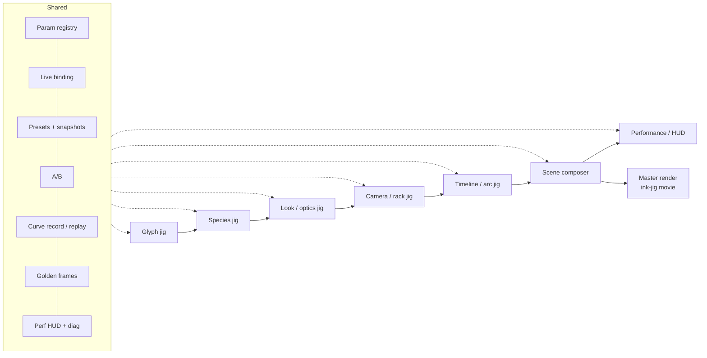
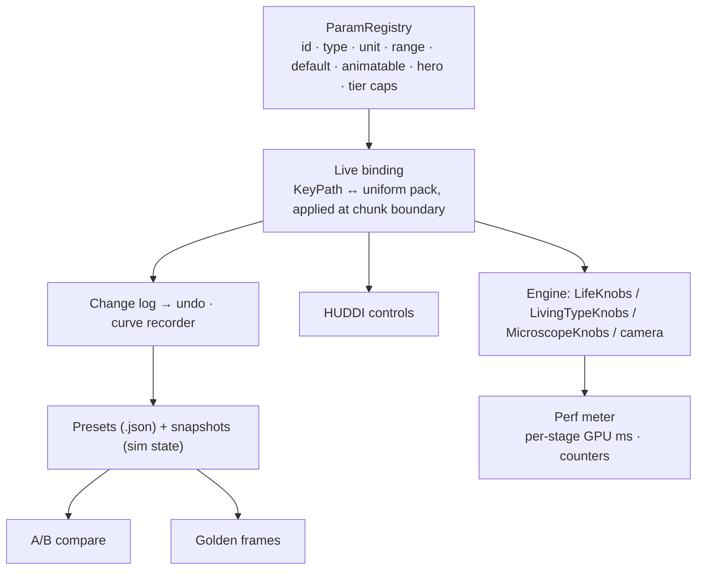
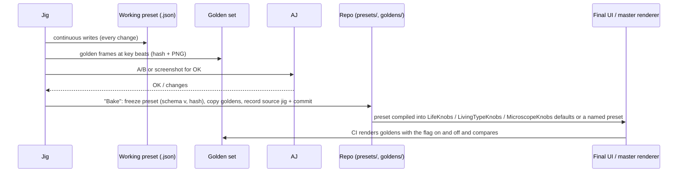

# Jig system [proposal]

AJ and Claude develop with **jigs**: small macOS tool apps, each built to tweak one thing, whose results are **baked** into the final UI/UX. This chapter designs the full jig family for living type, the infrastructure they share, and the path from a tweak to a shipped preset.

> Precedents: an earlier composer jig in AJ's studio ("isolate → fixture → tune → port", writes JSON continuously with no Save button, "jig before app UI"), the macOS ink jig itself (galleries, brush cards, a CLI with `bench | life | lifecards | gallery | movie`), the HUDDI kit (`docs/COMPONENTS.md`, `docs/SYSTEM.md`), a web `?meter=1` / diag measuring habit, and the Mac test-bridge plan (golden sets, what to measure).

## 1. Principles

1. **One jig, one question.** A jig isolates a single layer on a fixture (a fixed glyph set, a fixed sim cache, a fixed seed) so a change can only come from the knob being tuned.
2. **Same engine, same schema.** Every jig links the same `PaintCore` + living-type modules and reads/writes the [param schema](param-schema.md). Nothing a jig does is jig-only maths.
3. **Writes continuously.** Like the composer jig: no Save button; every change lands in the working preset file and the undo history.
4. **Deterministic by default.** Fixed `dt`, seeded RNG, fixed-latency readbacks; "reroll" changes only the seed.
5. **Measured, not guessed.** Every jig has the perf HUD and a golden-frame button.
6. **Chrome is HUDDI, from the existing kit only.** No new glyphs or components (HUDDI law 8: "edit → preview → AJ approve → ship").

## 2. The jigs



| Jig | Question it answers | Fixture | Main view | Writes |
|---|---|---|---|---|
| **Glyph jig** | Does this font / drawing / path produce good field products for the species I want? | text + font, or a stroke/SVG/image | overlays: mask, SDF iso-lines, skeleton graph, tangent field (line integral), counters, gaps, id map, feature points; stroke width **in sim cells** per glyph | `scene.glyphs` |
| **Species jig** | Does this species grow in, hold and decay the way I want? | a frozen GlyphFields bake, a fixed seed, optics **off** by default (judge the sim without the microscope, doc 42 §9 risk 6) | sim channels (trail, density, ecology N/I/X, arrival, agents as points), a legibility scrubber, coverage-per-glyph plot | `layers[i].species`, hero list |
| **Look / optics jig** | Does the material read as real (or as HUDDI)? | a cached sim run (`Z`, accent, granules per frame, like the preview's `/tmp/looks_*` caches) | the look at full / mid / cheap side by side (cf. `darkfield-tiers-sbs.mp4`), pass-by-pass view (φ, E, ridge, DOF, bloom, tone) | `look` |
| **Camera / rack jig** | Is the focus where the eye should be? | cached sim + look | CoC heat map, focal plane overlay, tracking target (front centroid / nucleus) and its smoothed path, zoom path over the layout | `camera` |
| **Timeline / arc jig** | Do the beats land? | full scene at preview tier | the arc curve, lifecycle state per glyph, unlock times, events, coverage vs target `C*(t)` | `timeline`, per-layer `legibility` |
| **Scene composer** | Does it all work together? | full scene | program view + layer list + inspector (geometry stable; selection swaps the inspector, not the frame) | the whole preset |
| **Performance / HUD** | Can it be played live at the target tier? | a finished preset | full-screen output; HUDDI control surface with hero knobs only; perf meter | performance recordings (curves), tier choice |

### 2.1 Glyph jig

- **Inputs:** font picker (registry-aware: warns when the word or font repeats per AJ's rule, reads `visuals/maker/used-words-fonts.md`), axis sliders for every axis the font exposes, PencilKit canvas (on Mac: tablet or mouse), SVG drop, image drop.
- **Checks:** stroke width in sim cells vs each species' minimum (cell species need ≥ 5 cells across, per V4's gap), counters open/closed, skeleton junction count, how many glyphs and their order.
- **Buttons:** rebake, quantise axes to baked steps, export field PNGs for goldens.

### 2.2 Species jig

- Registry-driven inspector: every param of the species with unit, range and default; hero knobs pinned at the top.
- Legibility: a slider plus "play arc" (default `arc`, `sweep`, `reverse`).
- Diagnostics: agent count, births/deaths per tick, coverage inside/outside per glyph (`lifeCoverage`), front speed, IoU vs `Tg` at the hold.
- One-click "port check": render the same seed with the Python cache side by side (the preview clip is the look spec).

### 2.3 Look / optics jig

- Modes per [Controls §6](controls.md#_6-look); palette swatches editable but HUDDI locked unless "labelled palette" is on (requires a label string).
- Tier switch with live cost per pass (from GPU timestamps).
- Wipe tool for V8-style filter-turret transitions.

### 2.4 Camera / rack jig

- Keyframe lanes for zoom (`pchipLog`), centre (named targets), focus target, tilt, defocus, maxr.
- **Track mode** preview: show the raw front centroid, the σ 0.9 s smoothed path and the slew-limited path (`looks.track_plane`), so the loved "focus follows the growing edge" can be tuned per clip.
- CoC readout under the cursor in px.

### 2.5 Timeline / arc jig

- Arc editor with the named arcs as starting points; drag keys; see `legibility(u)` and the resulting `attract / leak_px / counter / consume` live.
- Per-glyph lanes: lifecycle state, unlock time, coverage. Events list (doc 42 `ScoreEvent`).
- Beat import (a list of times; no live audio in the sim).

### 2.6 Scene composer

- Layers (species × legibility × blend), glyph source, look, camera and timeline in one window; renders at preview tier; "Master…" hands the preset to the recorder (the ink-jig CLI's `movie` command) at full tier.

### 2.7 Performance / HUD

- Runs a preset live at a chosen tier; only hero knobs, legibility, focus and seed are exposed.
- Records every knob movement as a curve (see §3.5) so a performance can be replayed offline at master quality.

## 3. Shared infrastructure



### 3.1 Param registry

One table per species/look/camera, declared next to the code that uses it:

```swift
public struct ParamSpec: Codable {
    public var id: String              // "STARVE"
    public var group: String           // "physarum"
    public var type: ParamType         // .float, .int, .bool, .enum([String]), .colour
    public var unit: String            // "/s", "px", "deg", "em", "×", ""
    public var range: ClosedRange<Double>
    public var defaultValue: Double
    public var animatable: Bool
    public var hero: Bool
    public var tierCap: [Tier: Double]? // e.g. agent counts per tier
    public var help: String            // one line, shown in the inspector
    public var source: String?         // "physarum_word.py: STARVE env (default 0.022)"
}
```

The registry is the single source for inspectors, HUD binding, schema validation, docs tables and the web exporter's uniform layout.

### 3.2 Live binding

- UI writes go to a staging copy; the engine picks them up **at the next chunk boundary** (32 sim steps), the same rule as live text edits, so a recorded session replays bit-identically.
- Look and camera params apply per output frame (they don't touch sim state).
- Each binding maps to a field in a `SIMD4` uniform pack (house style: packs with comments, `LU`, `SU`), so binding is a memcpy, not a rebuild.

### 3.3 Presets and snapshots

| Thing | Contains | Size | Use |
|---|---|---|---|
| **Preset** | schema JSON (knobs, curves, glyph source, seed) | KB | the deliverable; diffable; baked into the app |
| **Snapshot** | preset + sim state at time t (`Snapshot` via H4: textures + buffers + `lifeSteps`) | MB | jump to "mid-rot" instantly; A/B from the same state |
| **Keyframe** | snapshot every N chunks during a run | MB each | undo by replay (the macOS ink jig `PERFORMANCE.md` #5) |

### 3.4 A/B

- Two presets (or a preset and a snapshot) render side by side or as a split wipe, same seed, same frame.
- Blind mode: shuffles L/R, AJ picks, the pick is logged with both preset hashes.
- Diff view: per-pixel |A − B| heat map and the param diff list.

### 3.5 Record and replay of param curves

- Every change is logged as `(simTime, paramId, value)` with sim-time stamps; HUD drags are sampled at chunk boundaries.
- A recording converts to `Track`s in the preset (thinned with Ramer–Douglas–Peucker at a per-param tolerance), so a live performance becomes editable keyframes.
- Replay drives the same binding path, so offline master == live session (acceptance in doc 42 M3: record Pencil strokes and knob changes, replay → bit-identical final frame).

### 3.6 Deterministic seeds

- Scene seed + per-layer salt; RNG keyed to `(id, lifeSteps, salt)` (`hash21`), never thread index.
- "Reroll" = new seed only; the seed is part of the preset and of every golden's key.
- Per-device determinism (the internal perf notes): hashes match on one device; other families compare perceptually.

### 3.7 Golden-frame regression tests

| Golden | Source of truth | Check |
|---|---|---|
| Engine parity (flag off) | committed `docs/visual/**` in the macOS ink jig | mean ≤ 0.4, p99 ≤ 4 (existing `PERFORMANCE.md` bar) |
| Living-type frames | `docs/visual/living-type/` (doc 42 §2.3) | bit-exact hash on the same GPU family; tolerant diff (mean ≤ 0.5) across families |
| Bridge render jobs | doc 46 golden set, e.g. `m5-macos26-xcode26-v1` | `max_abs 2`, `pct_over 0.10`, `deltaE_p99 1.0`; blessing needs AJ's key |
| Legibility knob | mycelium *LIGATURE* stills at legibility 1.0 / 0.5 / 0.0 (INVENTORY) | re-render from Metal, compare structure (IoU vs `Tg`, coverage) |
| Division timing | bacteria *multiply* (deterministic fission) | cell count per frame curve |
| Optics tiers | `darkfield-tiers-sbs.mp4`, `darkfield-focus-rack.mp4` | perceptual diff per tier |
| Hold readability | any preset at its hold beat | IoU(B > 0.5, `Tg`) ≥ 0.8 (OCR-free, doc 42 §9 risk 3) |

The jig's golden button writes `{preset hash, seed, frame, device family, tier} → PNG + texture hash`. CLI: `ink-jig life --golden <scene>` (build-plan milestone M5).

### 3.8 Perf HUD and diag (`?meter`-style)

Modelled on a web habit: `?meter=1` (frame broken into per-stage milliseconds) and a `diag()` dump:

- **Meter line:** `glyph · sim×k · field · eco · body · optics · comp · present = total / budget` in GPU ms, from one compute encoder per stage + `MTLCounterSampleBuffer` at stage boundaries (`supportsCounterSampling(.atStageBoundary)`), plus `commandBuffer.gpuStartTime/gpuEndTime`. the ink jig's existing **H** HUD already shows GPU ms.
- **Diag dump** (`diag` command / menu): device family, tier, sim and render resolution, agent counts per species, field formats, `lifeSteps`, adaptive-budget steps per tick, sim speed vs real time, `ProcessInfo.thermalState`, preset hash, seed.
- **Thresholds** come from the per-stage budget table measured on each device (the frame is 16.67 ms at 60 fps, 8.33 ms at 120 Hz); the meter turns `warn` (`#ff8800`) when a stage exceeds its budget row.
- Launch flags mirror the web habit: `--meter`, `--diag`, `--tier mid`, `--golden`.

## 4. HUDDI controls (existing kit only)

The kit's builders (`createHuddi(root)`, `docs/COMPONENTS.md`) are the whole vocabulary:

| Need | Kit builder | Notes |
|---|---|---|
| continuous knob (legibility, hero knobs, focus, maxr) | `buildSlider` (row, bar `BAR_W` 18), optional `buildNotchBar` notches | notch vocabulary: full block = selected, light shade = enabled, middle dot = disabled, light horizontal = track |
| on/off (track focus, optics on, labelled palette) | `buildToggle` | cutout when on |
| enum (look mode, tier, arc preset, species) | `buildCycler` | pair with `cycle-blink` motion (600 ms) |
| action (reroll, golden, A/B swap, master) | `buildButton` | box button ≥ 5×3 |
| live value (GPU ms, agents, coverage, CoC) | `buildReadout` | |
| section title | `buildHeader` | |
| focal point / tilt | `buildXYPad` (7×5) | ghost others on drag |
| centred 2D (camera pan nudge, wind direction) | `buildJoySquare` | centre snap |
| vertical trim (zoom, defocus) | `buildVBar` (3×5) | |

Rules that apply: Silkscreen 400 only; integer `--s` (overlays usually `--s: 2`, touch pages `--s: 3`); **cutout = selection, never opacity**; ghost = middle-dot rails (`dimExcept`/`undim`/`ghostMask`); menu width 20; no dead controls. **FaderBank (3×10) is not in the inventory**: use four `buildVBar`s or sliders until AJ promotes it. Any new glyph (e.g. a species icon) is proposed in the HUDDI repo, not drawn in a jig.

> The kit is JavaScript today (`@huddi/kit`). For Swift jigs: host the kit in a `WKWebView` overlay bound over a local message bridge, or use the Swift Silkscreen OSD port when it lands (on the roadmap: Claude ports them on the Mac). [open question]

The HUDDI chrome is instrument chrome, not the art: it never appears in a mastered clip (studio rule: "HUDDI ≠ brand").

## 5. Baking: from jig to final UI and presets



1. **Freeze**: the jig writes `presets/<id>.json` with `schema`, a content hash, the seed, and `provenance` (jig name, engine commit, preview clip it was matched against).
2. **Golden**: the frames at the arc's key beats (wander, lock-on at ~38 %, mid-hold, end) go into the golden set, keyed per device family.
3. **AJ OK**: "jig before app UI" (studio rule): no product chrome until AJ has OK'd jig screenshots.
4. **Promote**: hero knobs and their ranges become the **only** controls in the final UI for that preset; everything else is frozen in the preset. Ranges in the final UI are the registry range narrowed to what AJ approved.
5. **Compile**: presets compile to engine defaults (`LifeKnobs.livingType`, gallery entries in `LivingTypeGalleries.swift`, brush cards) so they appear in the ink jig's galleries and cards like every other species (doc 42 §10 house style).
6. **Guard**: CI runs the goldens; a preset change without re-blessed goldens fails.

What does **not** bake: jig-only overlays, debug channels, the A/B harness and the HUD meter thresholds.
