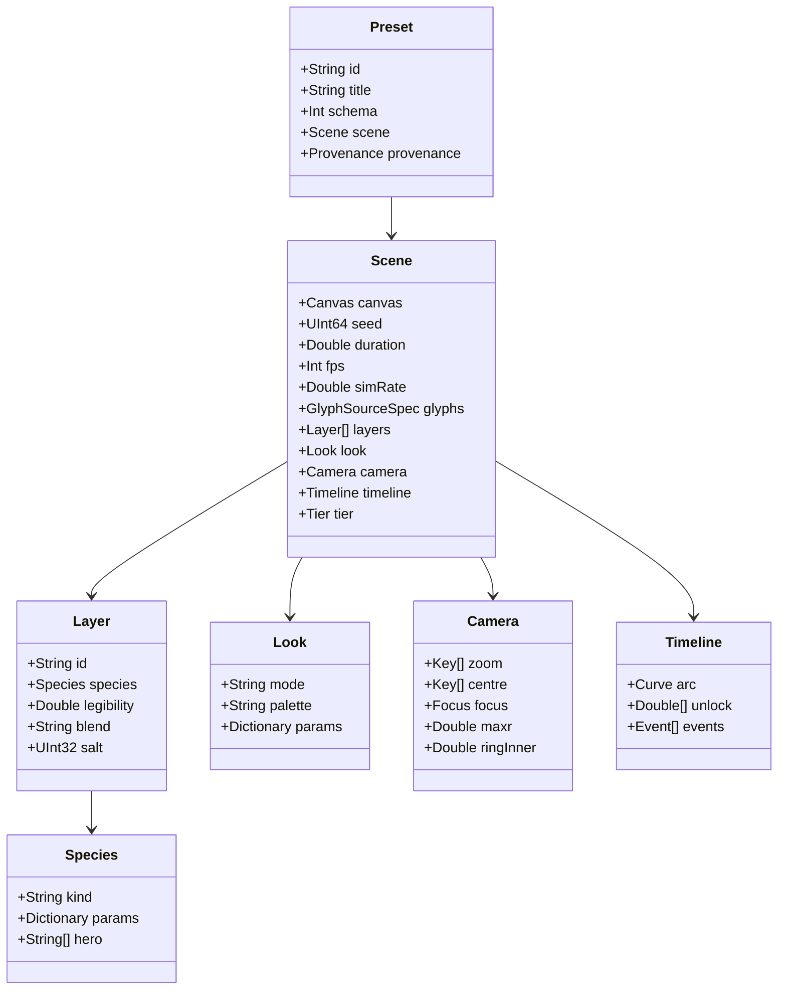

# Parameter schema [proposal]

A portable parameter schema, so one preset drives a jig, the macOS master renderer and a case-by-case WebGPU build. It is **Codable Swift structs** with a **JSON form** that round-trips exactly. Nothing here exists in code yet; it is a proposal that follows the engine conventions (doc 42 §2.3: Codable-compatible knobs, rates per second, pigments per species, SIMD4 uniform packs underneath) and the knob names already used in the preview.

> **Relationship to the engine:** at runtime the schema compiles down to `LifeKnobs` (+ `livingType: LivingTypeKnobs?`, H7), `MicroscopeKnobs` and a camera block. The schema is the **authoring and interchange** format; `LifeKnobs` stays the engine's own format and keeps decoding old scenes unchanged.

## 1. Object model



## 2. Swift

```swift
import Foundation

public let livingTypeSchemaVersion = 1

// MARK: - Animatable values

/// A value that is either constant or keyframed over time (seconds) or normalised time u (0..1).
public enum Animatable<T: Codable & Equatable>: Codable, Equatable {
    case constant(T)
    case keys(Track<T>)
}

public struct Track<T: Codable & Equatable>: Codable, Equatable {
    public enum Domain: String, Codable { case seconds, u }          // u = t / duration
    public enum Interp: String, Codable { case step, linear, smoothstep, pchip, pchipLog }
    public var domain: Domain = .seconds
    public var interp: Interp = .pchip
    public var keys: [Key<T>]
}

public struct Key<T: Codable & Equatable>: Codable, Equatable {
    public var t: Double
    public var v: T
    public var ease: String? = nil                                    // per-segment override
}

/// Named curves that already exist in the preview code.
public enum Curve: Codable, Equatable {
    case named(String)        // "arc" (legibility_at), "sweep", "reverse" (ink_bleed.leg_rev)
    case constant(Double)
    case keys(Track<Double>)
}

// MARK: - Preset

public struct Preset: Codable, Equatable {
    public var schema: Int = livingTypeSchemaVersion
    public var id: String                                             // "trust-the-process"
    public var title: String
    public var scene: Scene
    public var provenance: Provenance? = nil
}

public struct Provenance: Codable, Equatable {
    public var sourceScript: String?                                  // "visuals/mitosis/mitosis.py"
    public var previewClip: String?                                   // path relative to living-type/
    public var previewSeeds: [String: Int]? = nil                     // numpy seeds, informational only
    public var reaction: String? = nil                                // AJ's reaction: "LOVED", "👍", "DROPPED"
    public var notes: String? = nil
}

// MARK: - Scene

public struct Scene: Codable, Equatable {
    public var canvas: Canvas
    public var seed: UInt64 = 0
    public var duration: Double                                       // s
    public var fps: Int = 24                                          // output frame rate
    public var simRate: Double = 96                                   // sim steps per second of film time (fixed)
    public var glyphs: GlyphSourceSpec
    public var layers: [Layer]
    public var look: Look
    public var camera: Camera
    public var timeline: Timeline
    public var tier: Tier = .full
}

public struct Canvas: Codable, Equatable {
    public var width: Int                                             // output px
    public var height: Int
    public var world: Size2? = nil                                   // world extent; default = output size at zoom 1
    public var simScale: Double = 1.0                                 // sim res = world · simScale (physarum_word uses 0.5)
}

public enum Tier: String, Codable { case full, mid, cheap }

public struct Size2: Codable, Equatable { public var width: Double; public var height: Double }
public struct Point2: Codable, Equatable { public var x: Double; public var y: Double }

// MARK: - Glyphs

public struct GlyphSourceSpec: Codable, Equatable {
    public enum Kind: String, Codable { case font, stroke, path, image }
    public var kind: Kind
    public var lines: [String]? = nil                                 // font: one per line
    public var font: FontSpec? = nil
    public var asset: String? = nil                                   // stroke/path/image file
    public var layout: TextLayout = .init()
}

public struct FontSpec: Codable, Equatable {
    public var family: String                                         // "Inter"
    public var file: String? = nil                                    // repo-relative font file
    public var axes: [String: Animatable<Double>] = [:]               // "wght", "opsz", "wdth", custom tags
}

public struct TextLayout: Codable, Equatable {
    public enum Fit: Codable, Equatable { case width(Double), height(Double), size(Double) }
    public var fit: Fit = .width(0.84)
    public var tracking: Animatable<Double> = .constant(0)            // em
    public var leading: Animatable<Double> = .constant(1.2)           // × size (line pitch)
    public var align: String = "centre"
    public var anchor: Point2 = .init(x: 0.5, y: 0.5)                // normalised world position of the block centre
    public var grow: Double = 0                                       // stroke thickening, sim px
}

// MARK: - Layers and species

public struct Layer: Codable, Equatable {
    public var id: String
    public var species: Species
    public var legibility: Curve = .named("arc")                      // per layer; leak = 1 − legibility
    public var salt: UInt32 = 0                                       // RNG salt
    public var blend: String = "add"                                  // how its optical buffers combine
    public var enabled: Bool = true
}

public struct Species: Codable, Equatable {
    public var kind: String                                           // registry id: "mitosis", "physarum", "hyphae" …
    public var version: Int = 1
    public var params: [String: ParamValue]                           // validated against the registry entry
    public var hero: [String] = []                                    // 3–6 names surfaced in HUDs
}

public enum ParamValue: Codable, Equatable {
    case number(Double)
    case bool(Bool)
    case string(String)
    case numbers([Double])
    case track(Track<Double>)
}

// MARK: - Look

public struct Look: Codable, Equatable {
    public var mode: Animatable<String>                               // "darkfield" … (keys = V8-style wipes)
    public var palette: String = "huddi"
    public var colours: [String: String] = [:]                        // swatch → hex, overrides for labelled palettes
    public var paletteLabel: String? = nil                            // required when palette != "huddi": "real-ish colour"
    public var params: [String: ParamValue] = [:]
}

// MARK: - Camera

public struct Camera: Codable, Equatable {
    public var zoom: Animatable<Double> = .constant(1)
    public var centre: Animatable<String> = .constant("block")        // named target or "x,y" world px
    public var focus: Focus = .init()
    public var maxr: Double = 14                                      // px at 1600 wide
    public var ringInner: Double = 0.62
    public var vignette: Double = 0.35
}

public struct Focus: Codable, Equatable {
    public enum Axis: String, Codable { case y, x }
    public enum Track: String, Codable { case none, front, nucleus, target }
    public var axis: Axis = .y
    public var target: Animatable<String> = .constant("0.42")         // named target or normalised coordinate
    public var tilt: Animatable<Double> = .constant(0.55)             // CoC px at frame edge (mitosis) or plane slope (looks)
    public var defocus: Animatable<Double> = .constant(0)             // global defocus, px
    public var track: Track = .none
    public var trackSmoothing: Double = 0.9                           // s (σ of the zero-phase temporal Gaussian)
    public var slew: Double = 6                                       // px per frame
}

// MARK: - Timeline

public struct Timeline: Codable, Equatable {
    public var arc: Curve = .named("arc")
    public var unlock: [Double] = []                                  // per glyph (reading order), s
    public var events: [Event] = []
}

public struct Event: Codable, Equatable {                             // mirrors doc 42 ScoreEvent
    public var t: Double
    public var target: String                                         // "all", "glyph:3", "layer:cells"
    public var state: String? = nil                                   // seed, growIn, hold, decay, rot, eaten
    public var knob: String? = nil
    public var value: Double? = nil
    public var ease: String? = nil
}
```

## 3. JSON form

- Keys are the Swift property names. Enums with associated values encode as a single-key object: `{"constant": 0.85}`, `{"keys": {...}}`, `{"named": "arc"}`, `{"width": 0.84}`. Swift's synthesised Codable would write `{"constant":{"_0":0.85}}`, so `Animatable`, `Curve`, `Fit` and `ParamValue` get small hand-written `init(from:)` / `encode(to:)` (single-value container for `ParamValue`).
- Sizes and points encode as objects (`{"width":…,"height":…}`, `{"x":…,"y":…}`). CoreGraphics' own Codable writes arrays, so the schema uses `Size2` / `Point2` instead of `CGSize` / `CGPoint`.
- Numbers are JSON numbers; colours are `"#rrggbb"` strings; times are seconds unless `domain: "u"`.
- `ParamValue` encodes as the bare JSON value (number, bool, string, array) or a track object.
- Unknown keys are **rejected** by the jig loader (same rule as doc 46 job specs) and **ignored with a warning** by the master renderer, so newer presets still render.

## 4. Fields, units, ranges, defaults

**A** = animatable (keyframable). Ranges are design ranges for UI; the engine clamps.

### Scene / Canvas

| Field | Unit | Range | Default | A |
|---|---|---|---|---|
| `canvas.width`, `height` | px | 256–4096 | 1080 × 1080 | – |
| `canvas.world` | world px | ≥ canvas | = canvas | – |
| `canvas.simScale` | × | 0.25–1 | 1.0 (physarum_word: 0.5, 540 sim → 1080 out) | – |
| `seed` | u64 | any | 0 | – |
| `duration` | s | 1–60 | 10 | – |
| `fps` | Hz | 24, 30, 60, 120 | 24 | – |
| `simRate` | steps/s | 24–960 | 96 [proposal; preview varies: mitosis 4 sub-steps × 24, physarum_word 3 × 24] | – |
| `tier` | enum | full / mid / cheap | full | – |

### GlyphSourceSpec / TextLayout

| Field | Unit | Range | Default | A |
|---|---|---|---|---|
| `font.axes.<tag>` | axis units | font-defined | font default | ✓ |
| `layout.fit` | fraction or pt | 0.3–0.95 | `width 0.84` | – |
| `layout.tracking` | em | −0.05–0.25 | 0 | ✓ |
| `layout.leading` | × size | 0.9–2.0 | 1.2 | ✓ (C3 *leading*) |
| `layout.anchor` | normalised | 0–1 | (0.5, 0.5) | – |
| `layout.grow` | sim px | 0–3 | 0 | – |

### Layer

| Field | Unit | Range | Default | A |
|---|---|---|---|---|
| `legibility` | – | 0–1 | `"arc"` (constant default on new pieces: 0.8) | ✓ |
| `salt` | u32 | any | 0 | – |
| `blend` | enum | add, over, max, compete | add | – |

### Species (shared conventions; per-species params live in the registry)

| Field | Unit | Range | Default | A |
|---|---|---|---|---|
| rates | per second | ≥ 0 | species | ✓ |
| distances | world px (or sim px where named `*_px`) | ≥ 0 | species | ✓ |
| angles | degrees in JSON, radians in engine | 0–180 | species | ✓ |
| counts (`n_max`, `NM`) | count | tier-capped | species | – |
| `hero` | names | 3–6 | species | – |

### Look

| Field | Unit | Range | Default | A |
|---|---|---|---|---|
| `mode` | enum | darkfield, rheinberg, dic, phase, fluorescence, polarised, brightfield, brightfieldStained, gel, wax, mercury, stone, soil, paper, deepSea | darkfield | ✓ (step keys = wipes) |
| `palette` | id | huddi or a labelled palette | huddi | – |
| `params.kappa` | – | 0.5–4 | 2.4 | ✓ |
| `params.ringDirs` | count | 0 (closed form), 4, 8 | by tier | – |
| `params.ringBias` | – | 0–0.5 | 0.35 | ✓ |
| `params.ringAngle` | rad | −π–π | −0.6 | ✓ |
| `params.toneK` | – | 0.5–3 | 1.6 | ✓ |
| `params.bloomThreshold` / `bloomGain` | – | 0.3–0.9 / 0–1 | 0.55 / 0.35 | ✓ |
| `params.grainPhotons` | photons | 80–400 | 220 | – |
| `params.grainRead` | σ | 0–0.02 | 0.006 | – |

### Camera / Focus

| Field | Unit | Range | Default | A |
|---|---|---|---|---|
| `zoom` | × | 0.5–20 | 1 | ✓ (`pchipLog`) |
| `centre` | target or world px | – | `block` | ✓ |
| `focus.axis` | enum | y, x | y | – |
| `focus.target` | target or normalised | – | 0.42 | ✓ |
| `focus.tilt` | px at edge / slope | 0–30 / −1–1 | 0.55 | ✓ |
| `focus.defocus` | px | 0–20 | 0 | ✓ |
| `focus.track` | enum | none, front, nucleus, target | none | – |
| `maxr` | px @1600 | 0–30 | 14 | ✓ |
| `ringInner` | ratio | 0.3–0.8 | 0.62 | – |
| `vignette` | – | 0–0.6 | 0.35 | – |

### Timeline

| Field | Unit | Range | Default | A |
|---|---|---|---|---|
| `arc` | curve | – | `{"named":"arc"}` | (is a curve) |
| `unlock[]` | s | 0–duration | [] (all at 0) | – |
| `events[]` | – | – | [] | – |

## 5. Example: *Trust the process*

From `visuals/mitosis/mitosis.py` (22 s, 1080×1920, 24 fps; Inter 4.1 `wght 680 opsz 32`, tracking +0.05 em; `LEG 0.85`; AJ: LOVED 🔥). Every number below is read from the script; fields the script doesn't have are marked in `notes`.

```json
{
  "schema": 1,
  "id": "trust-the-process",
  "title": "Trust the process",
  "provenance": {
    "sourceScript": "visuals/mitosis/mitosis.py",
    "previewClip": "visuals/mitosis/trust-the-process.mp4",
    "previewSeeds": { "sim": 23, "cellSizes": 99, "floaters": 77, "grainBase": 10000 },
    "reaction": "LOVED",
    "notes": "zygote → metaphase green flash → cleavage 2-4-8-16 in zona → hatch → proliferate into T → migrants seed the rest"
  },
  "scene": {
    "canvas": { "width": 1080, "height": 1920, "world": { "width": 1080, "height": 1920 }, "simScale": 1.0 },
    "seed": 23,
    "duration": 22.0,
    "fps": 24,
    "simRate": 96,
    "tier": "full",
    "glyphs": {
      "kind": "font",
      "lines": ["Trust", "the", "process"],
      "font": { "family": "Inter", "file": "visuals/mitosis/fonts/InterVariable.ttf",
                "axes": { "opsz": { "constant": 32 }, "wght": { "constant": 680 } } },
      "layout": { "fit": { "width": 0.8889 }, "tracking": { "constant": 0.05 },
                  "leading": { "constant": 1.20 }, "align": "centre", "anchor": { "x": 0.5, "y": 0.4583 }, "grow": 0 }
    },
    "layers": [
      {
        "id": "cells",
        "salt": 0,
        "blend": "add",
        "legibility": { "constant": 0.85 },
        "species": {
          "kind": "mitosis",
          "version": 1,
          "hero": ["RF", "LEG", "GAPK", "T_REL", "unlockSpacing"],
          "params": {
            "RF": 7.5,
            "radiusJitter": [0.72, 1.28],
            "RC": 5.5,
            "R0": 22.0,
            "RZ": 25.52,
            "T_REL": 3.95,
            "NM": 9000,
            "subSteps": 4,
            "KR": 40.0, "KA": 3.0, "KS": 14.0,
            "cleavageTimes": [0.40, 2.12, 2.86, 3.46],
            "cleavageDurations": [[0.80, 0.90], [0.35, 0.38], [0.28, 0.30], [0.24, 0.26]],
            "mitosisPhaseTimes": [0.16, 0.20],
            "divisionFreeFraction": [0.05, 0.09],
            "deathOutsideAfter": 0.7,
            "migrantSpeedClamp": [50, 240],
            "straysAfter": 13.0,
            "GAPK": { "domain": "seconds", "interp": "smoothstep", "keys": [ { "t": 4.2, "v": 0.0 }, { "t": 7.0, "v": 0.38 } ] }
          }
        }
      }
    ],
    "look": {
      "mode": { "constant": "darkfield" },
      "palette": "huddi",
      "colours": { "bg": "#0d0d0d", "ink": "#e8e8e8", "cream": "#f5e6a8", "mid": "#666666", "green": "#33ff66", "hi": "#00ff88" },
      "params": {
        "ringDirs": 8, "scales": [1.0, 2.5],
        "toneK": 1.6, "toneKLowZoom": 1.3,
        "bloomThreshold": 0.55, "bloomGain": [0.35, 0.25], "bloomSigma": [6, 18],
        "vignette": 0.38,
        "grainPhotons": 320, "grainRead": 0.0035,
        "accentHiAbove": 0.9,
        "greenSparseAtLowZoom": [1.3, 4.0]
      }
    },
    "camera": {
      "zoom": { "keys": { "domain": "seconds", "interp": "pchipLog", "keys": [
        { "t": 0.0, "v": 12.5 }, { "t": 1.2, "v": 12.0 }, { "t": 2.3, "v": 10.2 }, { "t": 4.1, "v": 6.2 },
        { "t": 6.5, "v": 3.0 }, { "t": 8.2, "v": 1.9 }, { "t": 9.8, "v": 1.5 }, { "t": 12.2, "v": 1.28 },
        { "t": 16.6, "v": 1.0 }, { "t": 22.0, "v": 0.965 } ] } },
      "centre": { "keys": { "domain": "seconds", "interp": "pchip", "keys": [
        { "t": 0.0, "v": "E" }, { "t": 1.2, "v": "E" }, { "t": 2.3, "v": "E" }, { "t": 4.1, "v": "ET" },
        { "t": 6.5, "v": "T" }, { "t": 8.2, "v": "TW" }, { "t": 9.8, "v": "W" }, { "t": 12.2, "v": "WB" },
        { "t": 16.6, "v": "B" }, { "t": 22.0, "v": "B" } ] } },
      "focus": {
        "axis": "y",
        "target": { "keys": { "domain": "seconds", "interp": "pchip", "keys": [
          { "t": 0.0, "v": "E" }, { "t": 1.1, "v": "E" }, { "t": 6.0, "v": "T" }, { "t": 9.6, "v": "L0" },
          { "t": 12.6, "v": "L0" }, { "t": 15.6, "v": "L2" }, { "t": 17.4, "v": "M" }, { "t": 22.0, "v": "M" } ] } },
        "tilt": { "keys": { "domain": "seconds", "interp": "pchip", "keys": [
          { "t": 0.0, "v": 10 }, { "t": 1.1, "v": 10 }, { "t": 6.0, "v": 12 }, { "t": 9.6, "v": 14 },
          { "t": 12.6, "v": 26 }, { "t": 15.6, "v": 16 }, { "t": 17.4, "v": 4 }, { "t": 22.0, "v": 3.5 } ] } },
        "defocus": { "keys": { "domain": "seconds", "interp": "pchip", "keys": [
          { "t": 0.0, "v": 9.0 }, { "t": 1.1, "v": 0.0 }, { "t": 22.0, "v": 0.0 } ] } },
        "track": "none"
      },
      "maxr": 30,
      "ringInner": 0.62,
      "vignette": 0.38
    },
    "timeline": {
      "arc": { "constant": 0.85 },
      "unlock": [0.0, 5.6, 6.2, 6.8, 7.4, 8.6, 9.1, 9.6, 9.9, 10.3, 10.7, 11.1, 11.5, 11.9, 12.3],
      "events": [
        { "t": 3.95, "target": "glyph:1", "state": "growIn", "knob": "zonaRelease", "value": 1 },
        { "t": 16.0, "target": "all", "state": "hold" }
      ]
    }
  }
}
```

Notes on the mapping:
- **Named camera targets** come from the layout: `E` embryo (T crossbar/stem junction), `T`, `W` (letters 1–5), `B` (whole block, +40 px), `ET`, `TW` (0.62·T + 0.38·W), `WB` (0.6·W + 0.4·B); focus targets `E` (embryo y), `T` (embryo y + 60), `L0`/`L2` (centre of line 0/2) and `M` (block centre − 40). The two events mirror the script: the zona dissolves at `T_REL` 3.95 s, and `stage(t)` calls everything after 16 s "living type" (the hold). The schema stores names; the camera resolver turns them into world coordinates from the GlyphSet.
- **Tilt here is CoC px at the frame edge** (the mitosis convention); the CoC also adds `0.22·(wx − cx)` so the plane is slightly diagonal. The looks convention (plane slope) is different; the camera jig shows both and the schema records which by `focus.axis` + species.
- `layout.fit` 0.8889 = 960/1080 (mitosis sizes "process" to 960 px). `anchor.y` 0.4583 = 880/1920. Line gap is `0.20·size`; `leading 1.20` is an approximation of that [verify against the CT line metrics].
- `simRate` 96 = 24 fps × `SUB = 4`. The stage captions (`stage(t)`) are not part of the preset.

## 6. Example: *split* (V4)

From `visuals/maker/variations/v4-split/split_mitosis.py` (a patched copy of `mitosis.py` made by `make_copy.py`; 9.5 s, 1080×1080, 24 fps; Archivo `wdth 125 wght 800`, +0.06 em; fluorescence look; AJ: LOVED ❤️).

```json
{
  "schema": 1,
  "id": "split",
  "title": "SPLIT",
  "provenance": {
    "sourceScript": "visuals/maker/variations/v4-split/split_mitosis.py",
    "previewClip": "visuals/maker/variations/v4-split/split-mitosis-clip.mp4",
    "previewSeeds": { "sim": 23, "cellSizes": 99, "floaters": 77, "grainBase": 10000 },
    "reaction": "LOVED",
    "notes": "No zona; hero cell in the P stem; every letter pre-seeded; word full by ~3 s, readable from ~4.3 s. Gaps: strokes only ~3 cells wide; little division after 3 s."
  },
  "scene": {
    "canvas": { "width": 1080, "height": 1080, "world": { "width": 1080, "height": 1080 }, "simScale": 1.0 },
    "seed": 23,
    "duration": 9.5,
    "fps": 24,
    "simRate": 96,
    "tier": "full",
    "glyphs": {
      "kind": "font",
      "lines": ["SPLIT"],
      "font": { "family": "Archivo", "file": "visuals/fontcast/fonts/Archivo[wdth,wght].ttf",
                "axes": { "wdth": { "constant": 125 }, "wght": { "constant": 800 } } },
      "layout": { "fit": { "width": 0.8704 }, "tracking": { "constant": 0.06 }, "align": "centre",
                  "anchor": { "x": 0.5, "y": 0.4444 }, "grow": 0 }
    },
    "layers": [
      {
        "id": "cells",
        "salt": 0,
        "blend": "add",
        "legibility": { "constant": 0.85 },
        "species": {
          "kind": "mitosis",
          "version": 1,
          "hero": ["RF", "LEG", "GAPK", "seedsPerArea"],
          "params": {
            "RF": 9.0,
            "radiusJitter": [0.72, 1.28],
            "RC": 5.5,
            "R0": 22.0,
            "T_REL": -1.0,
            "zona": false,
            "NM": 9000,
            "subSteps": 4,
            "KR": 40.0, "KA": 3.0, "KS": 14.0,
            "heroCell": { "letter": 2, "heightFrac": 0.62, "minDistFromSeeds": 70 },
            "seedsPerArea": 2600,
            "minSeedsPerLetter": 3,
            "cleavageTimes": [0.55, 2.55, 3.05, 3.5],
            "cleavageDurations": [[0.95, 1.0], [0.32, 0.34], [0.26, 0.28], [0.22, 0.24]],
            "straysAfter": 6.0,
            "tissueSd": true,
            "GAPK": { "domain": "seconds", "interp": "smoothstep", "keys": [ { "t": 2.4, "v": 0.0 }, { "t": 4.0, "v": 0.46 } ] }
          }
        }
      }
    ],
    "look": {
      "mode": { "constant": "fluorescence" },
      "palette": "fluor-v4",
      "paletteLabel": "real-ish colour (membrane dye magenta, Hoechst-like cyan DNA)",
      "colours": { "bg": "#040406", "membrane": "#ff3d8b", "dna": "#3fd0ff", "cytoplasm": "#7a2a8a", "hi": "#e8f6ff" },
      "params": {
        "toneK": { "membrane": 1.25, "cytoplasm": 1.0, "dna": 1.3 },
        "bloomThreshold": 0.6, "bloomGain": [0.30, 0.18, 0.05], "bloomSigma": [5, 16, 10],
        "grainPhotons": 260, "grainRead": 0.003,
        "vignette": 0.30
      }
    },
    "camera": {
      "zoom": { "keys": { "domain": "seconds", "interp": "pchipLog", "keys": [
        { "t": 0.0, "v": 7.2 }, { "t": 1.2, "v": 7.0 }, { "t": 2.5, "v": 6.0 }, { "t": 3.3, "v": 2.6 },
        { "t": 4.3, "v": 1.06 }, { "t": 9.5, "v": 0.98 } ] } },
      "centre": { "keys": { "domain": "seconds", "interp": "pchip", "keys": [
        { "t": 0.0, "v": "E" }, { "t": 1.2, "v": "E" }, { "t": 2.5, "v": "E" }, { "t": 3.3, "v": "EB" },
        { "t": 4.3, "v": "B" }, { "t": 9.5, "v": "B" } ] } },
      "focus": {
        "axis": "x",
        "target": { "keys": { "domain": "seconds", "interp": "pchip", "keys": [
          { "t": 0.0, "v": "E" }, { "t": 0.7, "v": "E" }, { "t": 2.6, "v": "E" }, { "t": 3.5, "v": "E" },
          { "t": 4.3, "v": "C" }, { "t": 6.0, "v": "C" }, { "t": 6.9, "v": "R" }, { "t": 7.7, "v": "R" },
          { "t": 8.6, "v": "C" }, { "t": 9.5, "v": "C" } ] } },
        "tilt": { "keys": { "domain": "seconds", "interp": "pchip", "keys": [
          { "t": 0.0, "v": 8 }, { "t": 0.7, "v": 8 }, { "t": 2.6, "v": 10 }, { "t": 3.5, "v": 16 },
          { "t": 4.3, "v": 2.5 }, { "t": 6.0, "v": 2.5 }, { "t": 6.9, "v": 11 }, { "t": 7.7, "v": 11 },
          { "t": 8.6, "v": 2.0 }, { "t": 9.5, "v": 2.0 } ] } },
        "defocus": { "keys": { "domain": "seconds", "interp": "pchip", "keys": [
          { "t": 0.0, "v": 8.0 }, { "t": 0.7, "v": 0.0 }, { "t": 9.5, "v": 0.0 } ] } },
        "track": "none"
      },
      "maxr": 30,
      "ringInner": 0.62,
      "vignette": 0.30
    },
    "timeline": {
      "arc": { "constant": 0.85 },
      "unlock": [0.0, 0.0, 0.0, 0.0, 0.0],
      "events": []
    }
  }
}
```

Notes: the focus axis is **world x** (rack defocused → hero → zoom out with a tilted plane → whole word sharp → rack to the T with S/P soft → back to the whole word); the plane adds `0.15·(wy − cy)` and tilt is CoC px at **half-frame**. Named targets in `split_mitosis.camera/focus`: `E` hero cell, `B` block centre (+40 px in y), `EB` = 0.45·E + 0.55·B; focus `C` = block-centre x, `R` = mean x of the T (letter 5). `fit` 0.8704 = 940/1080; `anchor.y` 0.4444 = 480/1080. INVENTORY's next step for this preset: smaller cells / wider strokes (≥ 5 cells across) and staggered unlocks so divisions continue to ~7 s; in schema terms that is `RF ↓`, `layout.grow ↑` or a heavier `wght`, and a non-zero `unlock[]`.

## 7. Animatable parameters: rules

1. Only fields marked **A** accept a `Track`. The registry declares animatability per species param.
2. Tracks evaluate **in sim time** at chunk boundaries for sim params (so replay is exact) and **per output frame** for look/camera params.
3. `pchipLog` (PCHIP in log space) is the default for zoom, matching `mitosis.camera`.
4. Discrete tracks (`look.mode`, `centre` names) use `step` or a transition defined by the consumer (wipe, blend).
5. Legibility tracks are clamped to [0, 1]; the render snap `ℓ_render` is clamped to ≤ 0.6 separately.
