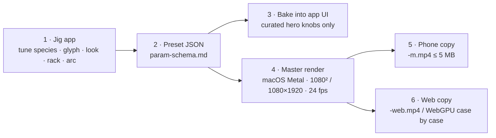

# Pipeline: jig → bake → master

The living-type workflow separates **interactive tuning** (in single-purpose macOS jigs), **preset baking** (into portable JSON/Swift structs), and **offline mastering** (deterministic 24 fps renders plus phone and web encodes).

## 1. Authoring in a jig

Each jig ([Jig system](jig-system.md)) exposes the full parameter surface of one stage (`GlyphJig`, `SpeciesJig`, `OpticsJig`, `CameraJig`, `ArcJig`) with live A/B comparison, curve recording, seed locking and a perf HUD. Changes bind directly to the Metal sim and post-stack (`PaintSim+Life.swift`, `MicroscopePass`) without recompiling shaders.

## 2. Baking presets

When a piece is approved, the jig exports a self-contained preset ([Parameter schema](param-schema.md)) carrying:
- `glyph`: text lines, font family + variable axes, tracking, leading, layout box.
- `species`: species id, hero knobs, seed, fixed `simRate` (steps per second of film time).
- `timeline`: the `legibility` arc (`wander → lock-on → hold → ease-out`) and per-glyph lifecycle offsets.
- `look`: microscope mode (`darkfield-huddi`, `rheinberg`, `dic`, `phase`, `fluorescence`, `polarised`, or material pass) and palette swatches.
- `camera`: zoom curve, tilted focal plane, rack keyframes or front-tracking target, max CoC radius.

Only the curated hero knobs surface in the final shipping UI; internal solver rates and thresholds stay baked in the preset.

## 3. Master render (macOS Metal)

The offline recorder (`MovieWriter.swift` over `AVAssetWriter`) steps the simulation at a fixed `simRate` independent of wall-clock frame time, runs the `MicroscopePass` at the **Full** tier, and writes:
- **Master video:** `1080×1080` (square plates) or `1080×1920` (vertical pieces such as *Trust the process* and *gravity always wins*), `24 fps`, linear-to-sRGB tone-mapped at the end of `dfTone`.
- **Golden stills:** `*-1-forming.png`, `*-2-formed.png`, or 4–5 beat stills (`*-still-1..5.png`) plus a side-by-side contact sheet for visual regression.

## 4. Phone and web encodes

Every master clip is accompanied by a lightweight phone encode (`_common/phone_copy.sh`) so clips preview cleanly in chat and on mobile:
- **Phone copy (`<name>-m.mp4`):** `scale='min(1280,iw)':-2`, `yuv420p`, `libx264` High@L4.0, starting at `CRF 26`, `-maxrate 3M -bufsize 6M`, `-movflags +faststart`, no audio. If the file exceeds `5,000,000` bytes (5 MB), CRF steps up by 2 (capped at 34) until it fits.
- **Web copy (`<name>-web.mp4`):** `CRF 22` re-encode used when a high-grain master (such as heavy darkfield or ciliate hatch) exceeds 15 MB.

## 5. Where the Python CPU preview fits

Everything under `visuals/` in the preview corpus was rendered on CPU (`numpy`, `scipy`, `numba`, `PIL`, `ffmpeg`) at `OMP_NUM_THREADS=1`. It serves as the **behavioural and optical reference**—defining the `legibility` contract, the ring-blur tilted CoC (`tilted_coc`), and the microscope looks (`looks.py`, `darkfield_huddi.py`)—before each kernel lands in Swift/Metal ([Porting](porting.md)).
