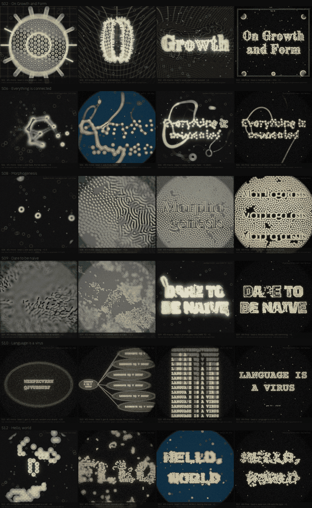

# Storyboards S01–S12

Twelve boards, one quote or phrase each. Every board uses the same camera grammar: a **dramatic zoom-out with a focus rack**, starting at unicellular scale (one cell, one hypha, one spot) and pulling back through colonies until multi-organism communities form the sentence. Each rendered board has four 540² keyframes (`kf1-micro`, `kf2-meso`, `kf3-macro`, `kf4-final`), a four-panel `strip.png`, and a full `board.md` breakdown.

**Six boards are fully rendered with keyframes and board notes (`S02`, `S06`, `S08`, `S09`, `S10`, `S12`)**; the remaining six (`S01`, `S03`, `S04`, `S05`, `S07`, `S11`) have specification stubs ready for their renders.

## Contact sheet of rendered strips (`S02`, `S06`, `S08`, `S09`, `S10`, `S12`)

## All twelve boards (S01–S12)

| # | Phrase | Source / note | System (simulated / candidate) | Look chain | Proposed font (OFL) | Status | Page |
|---|---|---|---|---|---|---|---|
| **S01** | *Life finds a way* | Jurassic Park / Michael Crichton | Mitosis / embryo cleavage (`mitosis`) | darkfield HUDDI | Inter / variable sans | **planned · stub** | [open](storyboards/S01/board.md) |
| **S02** | *On Growth and Form* | D'Arcy Thompson | Thompson coordinate warps + SDF morph on a radiolarian lattice | darkfield HUDDI → Rheinberg HUDDI cream | Old Standard TT Bold | **board + images** | [open](storyboards/S02/board.md) |
| **S03** | *All that you touch you change* | Octavia Butler | Aspergillus mycelium + anastomosing hyphae (`mycelium`) | stained brightfield → Rheinberg | Fraunces / variable serif | **planned · stub** | [open](storyboards/S03/board.md) |
| **S04** | *We are made of star-stuff* | Carl Sagan | Bioluminescent dinoflagellate bloom + radiolarian silica (`leading` / `radiolarian`) | deep-sea darkfield + epifluorescence | DM Serif Display / Kalnia | **planned · stub** | [open](storyboards/S04/board.md) |
| **S05** | *Nature uses only the longest threads to weave her patterns* | Richard Feynman | Siphonophore zooid chains + climbing tendrils (`siphonophore` / `tendril`) | darkfield HUDDI → Rheinberg teal | Handjet / Quicksand | **planned · stub** | [open](storyboards/S05/board.md) |
| **S06** | *Everything is connected* | Physarum / Tokyo rail (Tero et al. 2010) | Jones Physarum agents linking oat flakes on the letters | darkfield → Rheinberg → darkfield → cream | Overpass ExtraBold (`wght` 800) | **board + images** | [open](storyboards/S06/board.md) |
| **S07** | *Not by combat, but by networking* | after Lynn Margulis | Two-species symbiogenesis / territory contest (`contrast`) | darkfield HUDDI (dual accent) | Dela Gothic One + Lilita One | **planned · stub** | [open](storyboards/S07/board.md) |
| **S08** | *Morphogenesis* | Alan Turing | Gray–Scott reaction–diffusion; glyph mask is the (F, k) map | darkfield → DIC → DIC → cream | Gloock | **board + images** | [open](storyboards/S08/board.md) |
| **S09** | *Order from chaos* | Vicsek active rods (alt brief: *Dare to be naive*, Buckminster Fuller) | 7,000 Vicsek active rods steered by the legibility arc into nematic stroke flow | phase → DIC → darkfield → cream | Tektur (`wdth` 100, `wght` 800) | **board + images** | [open](storyboards/S09/board.md) |
| **S10** | *Methinks it is like a weasel* | Hamlet / Richard Dawkins (alt brief: *Language is a virus*, W. S. Burroughs) | Dawkins cumulative selection (100 daughters/gen, converges at gen 47) | fluorescence ×3 → cream | Courier Prime Bold | **board + images** | [open](storyboards/S10/board.md) |
| **S11** | *Less is more* | Mies van der Rohe | Reverse legibility arc (`leg_rev` 1.0 → 0.0): leaf venation skeletonising / ink bleed | backlit leaf / paper fibres → darkfield | Paytone One / Newsreader | **planned · stub** | [open](storyboards/S11/board.md) |
| **S12** | *Game of Life* | John Conway B3/S23 (alt brief: *Hello, world*) | Conway B3/S23 on a 180² torus + glyph bias gated by the legibility arc | darkfield → fluorescence → Rheinberg → cream | Press Start 2P | **board + images** | [open](storyboards/S12/board.md) |

All six fonts used in the rendered boards (`Old Standard TT Bold`, `Overpass ExtraBold`, `Gloock`, `Tektur`, `Courier Prime Bold`, `Press Start 2P`) are SIL OFL 1.1 and none is claimed yet in `visuals/maker/used-words-fonts.md`—claim a font there only when AJ approves its board.

## Conventions

- **Files per rendered board:** `Sxx/kf1-micro.png`, `kf2-meso.png`, `kf3-macro.png`, `kf4-final.png` (540² each, downscaled ≤ 400 KB in `site/`), `strip.png` (the four side by side), and `board.md`.
- **Label strip on every keyframe:** line 1 = board · keyframe · beat · scale; line 2 = what is real and what is faked; top right = look and focus (rack target, tilt, max CoC). The labels are part of the draft, not the final art.
- **Scale** (`×40`, `×4`, `×1` …) is the camera zoom relative to the whole dish at `×1`, not a microscope objective.
- **Optics** are the glab looks (`visuals/glab/src/looks.py`, `darkfield_huddi.py`) driven at 540² by `_src/sbkit.py`, with the ring-blur tilted CoC on every frame. Finals use the Rheinberg HUDDI cream look so the rendered boards end in one house style.
- **Real vs faked** is spelled out on every board: whenever a draft keyframe uses drawn overlays, procedural stand-ins, upsampled crops, or separate sims standing in for one camera move, both the keyframe label and `board.md` state it explicitly.

## How the boards map onto the system

| Board stage | Scale | What the engine does |
|---|---|---|
| `kf1-micro` | one organism, high zoom | a single seed of the species; focus racks onto it; `legibility` at the arc's wander value (0.2, or 0.0 in S12) |
| `kf2-meso` | a colony | the species spreads; focus follows the front (`track: front`); the look may switch through the filter turret |
| `kf3-macro` | many colonies | lock-on (35–40 % of the clip) pulls growth onto the strokes; tilted focal plane across the words |
| `kf4-final` | the sentence | hold at legibility 1.0 (40–75 %), near-flat focus, then the ease-out to 0.35 |

Camera zoom is a world-space transform before the post-stack, so the zoom-out never re-lays out the type (see [GlyphSource §3](glyph-source.md) and [Controls §5](controls.md)).
