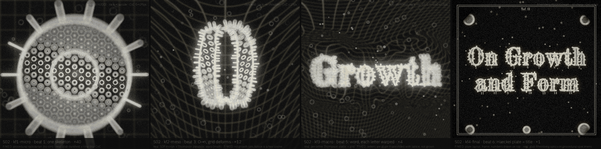
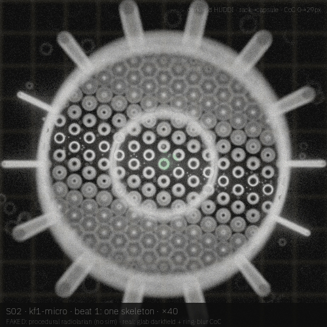
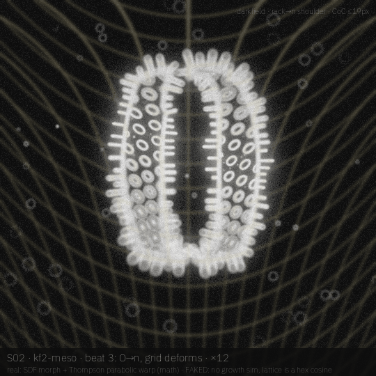
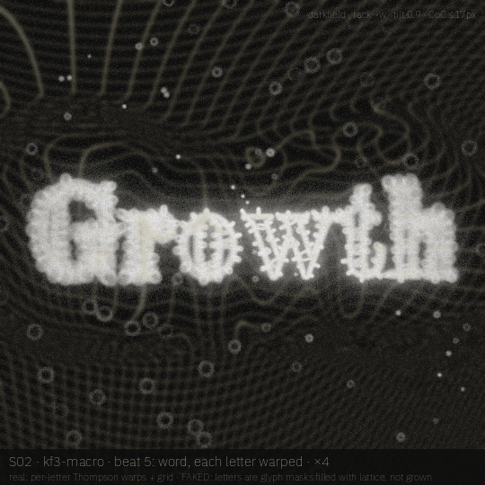
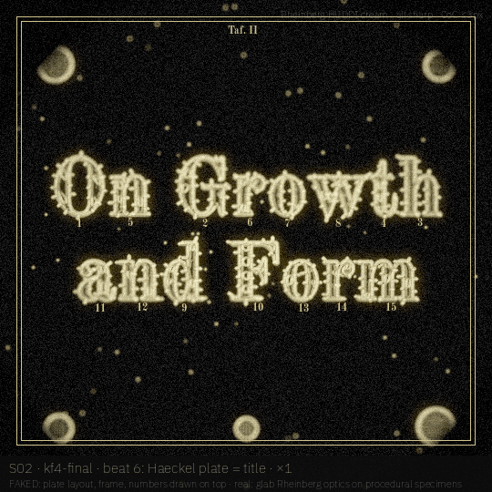

# S02 · *On Growth and Form*

D'Arcy Thompson's book as a single camera move: one radiolarian skeleton, then his coordinate grids bend it into letters, until a Haeckel plate spells the title.

| | |
|---|---|
| **Phrase** | On Growth and Form (two lines on the plate; *Growth* alone in beat 5) |
| **System** | procedural radiolarian lattice (hex cosine field + rim + spines) · Thompson coordinate warps (parabolic, shear, radial, log) · SDF morph O→n |
| **Look chain** | darkfield HUDDI (beats 1–5) → Rheinberg HUDDI cream (beat 6); ring-blur tilted CoC throughout |
| **Font** | **Old Standard TT Bold** (OFL 1.1, static; a 19th-century Modern revival, the type of Thompson's own era) · proposed, **not claimed** (not in `visuals/maker/used-words-fonts.md` as of 19 Oct 2026; claim it in the registry only if AJ approves the board) |
| **Legibility** | rises with the warp: 0.2 at the single skeleton, 0.8 at the word, 1.0 on the plate (default arc shape, no ease-out) |
| **Proposed clip** | 12 s · 24 fps · 1080² master, phone copy via `_common/phone_copy.sh` |

## Beats

| # | u (0–1) | scale | camera / focus | what happens | look |
|---|---|---|---|---|---|
| 1 | 0.00–0.15 | ×40 | rack onto the central capsule, spines soft | one radiolarian skeleton on an undeformed Cartesian grid | darkfield HUDDI |
| 2 | 0.15–0.30 | ×40→×12 | pull back, focus follows the rim | the grid starts to bend (parabolic warp, Thompson's fish figures); the lattice stretches with it | darkfield HUDDI |
| 3 | 0.30–0.45 | ×12 | rack to the shoulder of the n | the skeleton outline SDF-morphs O → n while the grid deforms under it | darkfield HUDDI |
| 4 | 0.45–0.60 | ×12→×4 | dolly right along the baseline | more letters bud off; each gets its own warp kind | darkfield HUDDI |
| 5 | 0.60–0.80 | ×4 | tilt 0.9, rack lands on the w | *Growth* as one word, every letter a differently warped specimen | darkfield HUDDI |
| 6 | 0.80–1.00 | ×1 | all sharp, CoC ≤3 px | the camera settles on a Haeckel-style plate (Taf. II, frame, figure numbers) that spells *On Growth and Form* | Rheinberg HUDDI cream |

## Keyframes (540², local drafts)

| file | beat | what you see |
|---|---|---|
| [`kf1-micro.png`](storyboards/S02/kf1-micro.png) | 1 | one skeleton, Cartesian grid, rack to the capsule (green accent = nucleus) |
| [`kf2-meso.png`](storyboards/S02/kf2-meso.png) | 3 | O → n morph half-way (t = 0.55) under a parabolic Thompson warp |
| [`kf3-macro.png`](storyboards/S02/kf3-macro.png) | 5 | *Growth*, a different warp per letter, rack to the w |
| [`kf4-final.png`](storyboards/S02/kf4-final.png) | 6 | the plate: title in lattice, corner specimens, frame, figure numbers |

|  |  |
|---|---|
| **`kf1-micro`** (beat 1) — one skeleton, Cartesian grid, rack to the capsule (green accent = nucleus) | **`kf2-meso`** (beat 3) — O → n morph half-way (t = 0.55) under a parabolic Thompson warp |
|  |  |
| **`kf3-macro`** (beat 5) — *Growth*, a different warp per letter, rack to the w | **`kf4-final`** (beat 6) — the plate: title in lattice, corner specimens, frame, figure numbers |

## Real vs faked

**Real (simulated or computed):**

- Thompson coordinate warps and the SDF morph (exact maths, per pixel)
- glab darkfield HUDDI + Rheinberg optics, ring-blur tilted CoC

**Faked or shortcut in these drafts:**

- no growth sim at all: the radiolarian is a procedural hex-cosine lattice and the letters are glyph masks filled with that lattice
- plate frame, *Taf. II* and figure numbers are drawn on top with PIL
- the camera move between keyframes is not rendered; four stills only

## Port notes [proposal]

- the warp is a pure function of (x, y, t): one Metal fragment pass over the glyph SDF, no state
- a real version could grow the lattice with the radiolarian species (`radiolarian-lattice`, not wired to the legibility knob yet) and only use the warp for the grid
- plate overlay belongs in the HUD/chrome layer, not the sim

## Open questions / risks

- **word rule:** *Growth* contains the banned word *grow*. Needs AJ's call: keep the book title as an exception, or swap to *On Form*.
- Old Standard TT Bold has no variable axes; if axis motion is wanted, an alternative is a variable Modern (none installed on the box yet).

## Source

- Render: `docs-src/storyboards/_src/s02.py` (imports `_src/sbkit.py`, which drives the glab looks in `visuals/glab/src/looks.py` and `darkfield_huddi.py` at 540²).
- Every keyframe carries its own label strip: board · keyframe · beat · scale on line 1, what is real vs faked on line 2, look + focus top right.
