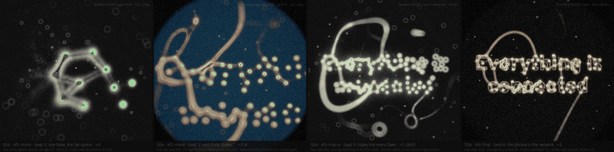
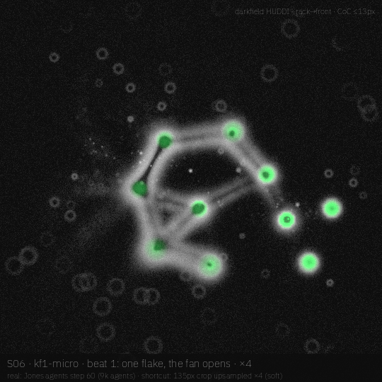
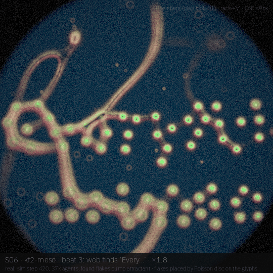
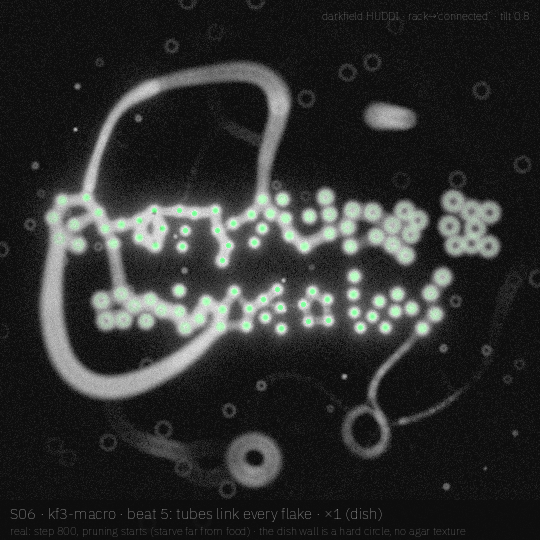
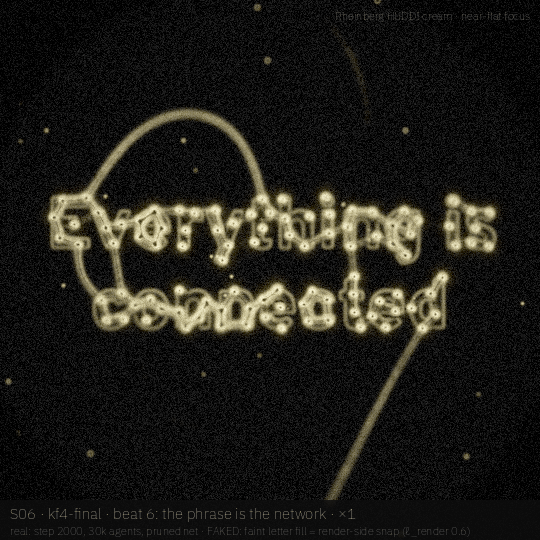

# S06 · *Everything is connected*

The Tero 2010 Tokyo-rail experiment set on a phrase: one oat flake seeds a Physarum plasmodium, oat flakes sit on the letters, and the transport network that links them becomes the type.

| | |
|---|---|
| **Phrase** | Everything is / connected (two lines) |
| **System** | Jones-style Physarum agents (sense–turn–move–deposit), oat flakes Poisson-placed on the glyphs (r 16 px), found flakes pump attractant, starvation prunes far-from-food agents |
| **Look chain** | darkfield HUDDI → Rheinberg (look-01) → darkfield HUDDI → Rheinberg HUDDI cream |
| **Font** | **Overpass ExtraBold** (`wght` 800 of a 100–900 variable; OFL 1.1; the Highway Gothic signage face, a nod to rail and road maps) · proposed, **not claimed** (not in `visuals/maker/used-words-fonts.md` as of 19 Oct 2026; claim it in the registry only if AJ approves the board) |
| **Legibility** | constellation first (flakes only), then tubes; final frame adds a render-side glyph snap at ℓ_render 0.6 |
| **Proposed clip** | 10 s · 24 fps · 1080² · `wght` could breathe 700↔900 on the final hold |

## Beats

| # | u (0–1) | scale | camera / focus | what happens | look |
|---|---|---|---|---|---|
| 1 | 0.00–0.10 | ×4 | on the seed flake, rack to the front | one flake on agar; the plasmodium fans out from it | darkfield HUDDI |
| 2 | 0.10–0.25 | ×4→×1.8 | pull back along the fan | exploratory web; the first flakes on *E* are found and light up | darkfield → Rheinberg |
| 3 | 0.25–0.40 | ×1.8 | rack to the y of *Every* | the web reaches the first word; found flakes start feeding attractant | Rheinberg |
| 4 | 0.40–0.60 | ×1.8→×1 | pull out to the whole dish | tubes thicken between flakes on both lines; loops form along the dish wall | darkfield HUDDI |
| 5 | 0.60–0.80 | ×1 | tilt 0.8, rack to *connected* | pruning: exploratory branches starve away, only links between food stay | darkfield HUDDI |
| 6 | 0.80–1.00 | ×1 | near-flat focus | the phrase reads as its own network, with a faint letter body | Rheinberg HUDDI cream |

## Keyframes (540², local drafts)

| file | beat | what you see |
|---|---|---|
| [`kf1-micro.png`](storyboards/S06/kf1-micro.png) | 1 | the seed flake and the fan at sim step 60 (9k agents), green = flakes already eaten |
| [`kf2-meso.png`](storyboards/S06/kf2-meso.png) | 3 | step 420: web on the first letters, flakes lit where found |
| [`kf3-macro.png`](storyboards/S06/kf3-macro.png) | 5 | step 800: the whole dish, both lines linked, pruning about to start |
| [`kf4-final.png`](storyboards/S06/kf4-final.png) | 6 | step 2000: pruned network (30k agents) + faint letter body |

|  |  |
|---|---|
| **`kf1-micro`** (beat 1) — the seed flake and the fan at sim step 60 (9k agents), green = flakes already eaten | **`kf2-meso`** (beat 3) — step 420: web on the first letters, flakes lit where found |
|  |  |
| **`kf3-macro`** (beat 5) — step 800: the whole dish, both lines linked, pruning about to start | **`kf4-final`** (beat 6) — step 2000: pruned network (30k agents) + faint letter body |

## Real vs faked

**Real (simulated or computed):**

- Jones Physarum: 110k agents max, SA 30°, RA 40°, SO 9 px, decay 0.90, 3×3 diffuse, saturating sensor `tv/(tv+25)` + a food smell term
- flakes only emit once eaten, so the tubes follow the order of discovery (not a beacon field)
- starvation after step 800 off food (prunes to ~30k agents)
- glab optics + ring-blur CoC

**Faked or shortcut in these drafts:**

- flake positions are a Poisson disc on the glyph mask (hand-placed in the lab version), not a free choice of the organism
- kf1 is a 135 px crop upsampled ×4, so it is soft
- the dish wall is a hard circle; no agar texture, no plasmodium sheet colour
- final frame: the faint letter fill is a render-side snap at ℓ_render 0.6 (allowed ceiling in controls §1.5), not sim

## Port notes [proposal]

- maps onto the existing slime path in the engine (`slimeSensor`, `slimeAngle`, `slimeTurn`, `slimeDecay`, `slimeFood`); flakes become a food texture with an `eaten` mask
- the `eaten` latch and starvation are two small extra kernels; no new species
- same food-field knobs as `physarum_word` (`fw_near`, `fw_far`, `STARVE`) could drive the arc

## Open questions / risks

- Physarum on a phrase is close to the existing physarum_word clips and V1/V7; the novelty is the flake/network reading. AJ may want it more distinct.
- two-line layout makes the network denser between lines than along them; *is* is the weakest word.

## Source

- Render: `docs-src/storyboards/_src/s06.py` (imports `_src/sbkit.py`, which drives the glab looks in `visuals/glab/src/looks.py` and `darkfield_huddi.py` at 540²).
- Sim: `docs-src/storyboards/_src/s06_sim.py`, cache in `/tmp/sb_s06/` (box-local, not committed). Run the sim first, then the render: `nice -n 10 python3 s06_sim.py && nice -n 10 python3 s06.py`.
- Every keyframe carries its own label strip: board · keyframe · beat · scale on line 1, what is real vs faked on line 2, look + focus top right.
