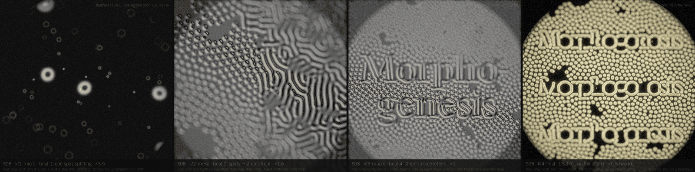
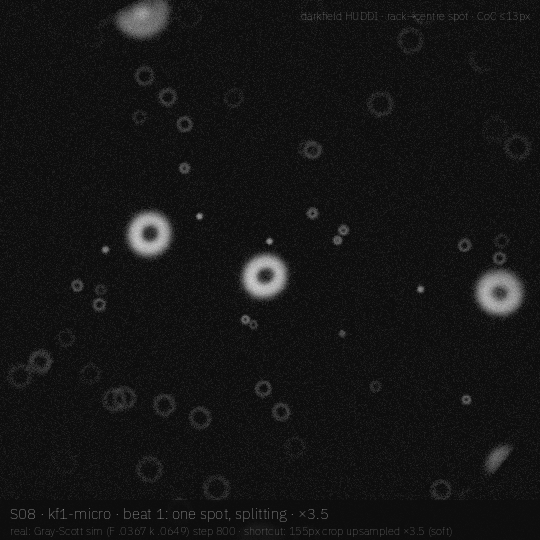
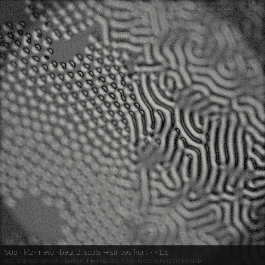
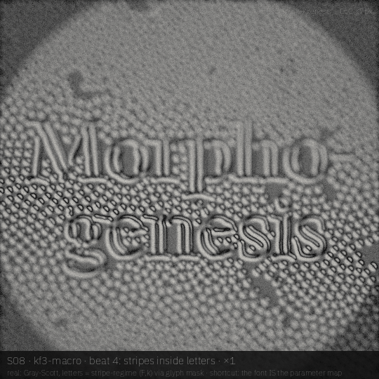
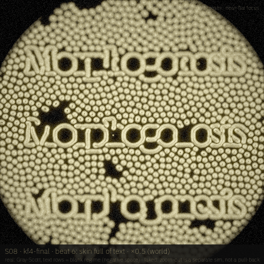

# S08 · *Morphogenesis*

Turing's 1952 idea run as type: one spot splits, spots turn into stripes across a front, the letters are the stripe regime, and the final skin carries the word as negative space.

| | |
|---|---|
| **Phrase** | Morpho- / genesis (two lines), then *Morphogenesis* repeated as skin |
| **System** | Gray–Scott reaction–diffusion at 540² with a spatial (F, k) map; the glyph mask *is* the parameter map |
| **Look chain** | darkfield HUDDI → DIC → DIC → Rheinberg HUDDI cream |
| **Font** | **Gloock** (OFL 1.1, static high-contrast serif) · proposed, **not claimed** (not in `visuals/maker/used-words-fonts.md` as of 19 Oct 2026; claim it in the registry only if AJ approves the board) |
| **Legibility** | carried by the regime contrast (spots outside vs stripes inside); no knob in the sim yet |
| **Proposed clip** | 10 s · 24 fps · 1080² · sim at 540 upscaled, as in the drafts |

## Beats

| # | u (0–1) | scale | camera / focus | what happens | look |
|---|---|---|---|---|---|
| 1 | 0.00–0.15 | ×3.5 | rack to a centre spot | one spot grows and splits (self-replicating spots, F .0367 k .0649) | darkfield HUDDI |
| 2 | 0.15–0.35 | ×3.5→×1.6 | pull back, rack across to the stripe side | a spots → stripes front sweeps across the dish (x-gradient in F, k) | DIC |
| 3 | 0.35–0.55 | ×1.6 | dolly into the front | the front settles; labyrinth meets the spot lattice | DIC |
| 4 | 0.55–0.75 | ×1 | rack to *genesis* | the word appears: stripes fill the letters, spots fill the rest | DIC |
| 5 | 0.75–0.90 | ×1→×0.5 | pull out (separate sim, see risks) | the word becomes one repeat in a skin | DIC → Rheinberg |
| 6 | 0.90–1.00 | ×0.5 | near-flat focus | a skin of spots with *Morphogenesis* rows as blank negative space | Rheinberg HUDDI cream |

## Keyframes (540², local drafts)

| file | beat | what you see |
|---|---|---|
| [`kf1-micro.png`](storyboards/S08/kf1-micro.png) | 1 | step 800, one splitting spot, 155 px crop ×3.5 |
| [`kf2-meso.png`](storyboards/S08/kf2-meso.png) | 2 | step 7000 of the gradient run: spots → stripes front |
| [`kf3-macro.png`](storyboards/S08/kf3-macro.png) | 4 | step 7000 of the word run: stripes inside the letters |
| [`kf4-final.png`](storyboards/S08/kf4-final.png) | 6 | step 7000 of the skin run: three *Morphogenesis* rows as the blank regime |

|  |  |
|---|---|
| **`kf1-micro`** (beat 1) — step 800, one splitting spot, 155 px crop ×3.5 | **`kf2-meso`** (beat 2) — step 7000 of the gradient run: spots → stripes front |
|  |  |
| **`kf3-macro`** (beat 4) — step 7000 of the word run: stripes inside the letters | **`kf4-final`** (beat 6) — step 7000 of the skin run: three *Morphogenesis* rows as the blank regime |

## Real vs faked

**Real (simulated or computed):**

- Gray–Scott (Du .16, Dv .08) explicit Euler at 540², 7000 steps per run; three runs (gradient, word, skin)
- the (F, k) map per pixel: spots (.0367, .0649), stripes (.029, .057), blank (.09, .059)
- glab DIC / Rheinberg optics + ring-blur CoC

**Faked or shortcut in these drafts:**

- kf1 is a crop upsampled ×3.5 (soft)
- the zoom-out to the skin is a separate sim, not a pull-back of one dish
- kf4 was re-run on 19 Oct (3 rows, 0.80 width, 1 px dilation instead of 5 rows at 44 px, which read as *Monuucs*): the word now reads, but Gloock's hairline joins (p, h, g, e) break where spots invade thin strokes

## Port notes [proposal]

- Gray–Scott is two textures and one compute kernel; (F, k) come from the GlyphSource SDF, so the font really is the parameter map
- add the legibility knob as the blend weight between regimes (`F = mix(F_out, F_in, ℓ·mask)`)
- M5 can run 1080² live; A12 likely needs 540² [est]

## Open questions / risks

- kf4 hairlines: a bolder cut or a 2 px dilation would keep the joins, at the cost of the counters filling; worth one more pass
- Gray–Scott type is well-trodden; the board's distinct move is font-as-parameter-map plus the skin.

## Source

- Render: `docs-src/storyboards/_src/s08.py` (imports `_src/sbkit.py`, which drives the glab looks in `visuals/glab/src/looks.py` and `darkfield_huddi.py` at 540²).
- Sim: `docs-src/storyboards/_src/s08_sim.py`, cache in `/tmp/sb_s08/` (box-local, not committed). Run the sim first, then the render: `nice -n 10 python3 s08_sim.py && nice -n 10 python3 s08.py`.
- Every keyframe carries its own label strip: board · keyframe · beat · scale on line 1, what is real vs faked on line 2, look + focus top right.
