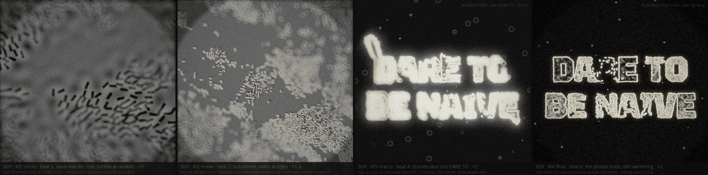
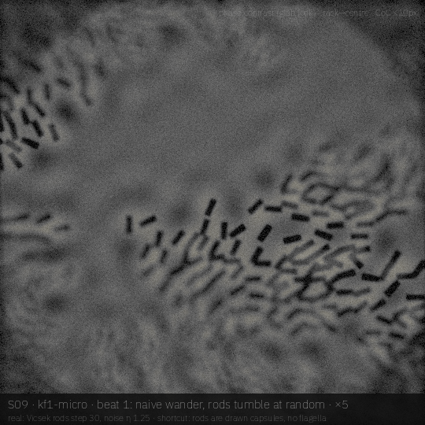
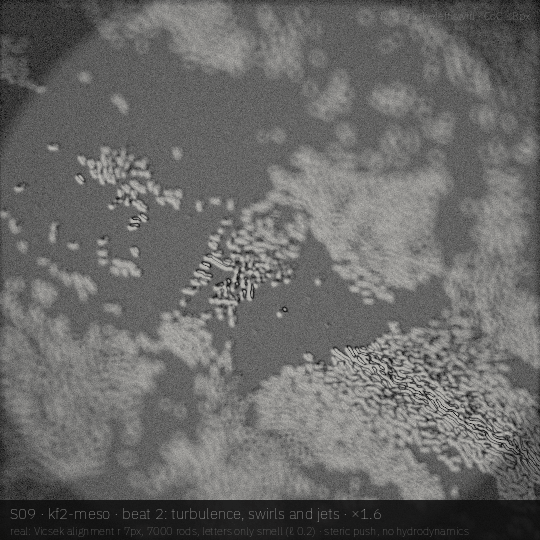
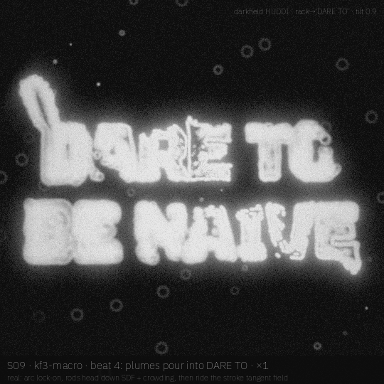
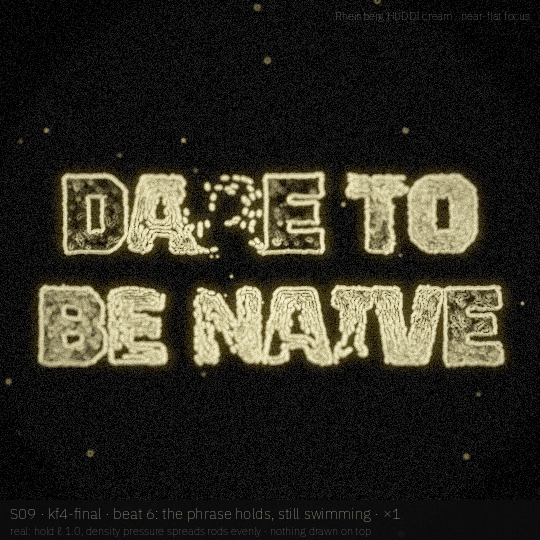

# S09 · *Dare to be naive*

Buckminster Fuller's maxim staged as bacterial turbulence that the legibility arc slowly takes over: thousands of swimming rods wander naively at random, then pour down the glyph SDF and stream along the strokes until the phrase holds while still swimming.

| | |
|---|---|
| **Phrase** | DARE TO / BE NAIVE (two lines, Buckminster Fuller) |
| **System** | Vicsek active rods (7000, speed 1.1 px/step, alignment r 7 px) + steric push; on lock-on they follow SDF + crowding, then the stroke tangent field (nematic), with density pressure to spread evenly |
| **Look chain** | phase contrast → DIC → darkfield HUDDI → Rheinberg HUDDI cream |
| **Font** | **Tektur** (`wdth` 100, `wght` 800 of a wdth 75–100 / wght 400–900 variable; OFL 1.1; squared, geodesic-facet forms that nod to Fuller) · proposed, **not claimed** (not in `visuals/maker/used-words-fonts.md` as of 19 Oct 2026; claim it in the registry only if AJ approves the board) |
| **Legibility** | default arc (`legibility_at(u, "arc")`): naive wander 0.2 → lock-on → hold 1.0; ease-out proposed for the clip, not in the drafts |
| **Proposed clip** | 10 s · 24 fps · 1080² · `wdth` could tighten 100 → 75 on the hold, so the swarm has to repack |

## Beats

| # | u (0–1) | scale | camera / focus | what happens | look |
|---|---|---|---|---|---|
| 1 | 0.00–0.15 | ×5 | rack to centre | naive wander: rods tumble at random, high noise | phase contrast |
| 2 | 0.15–0.30 | ×5→×1.6 | pull back, rack across a swirl | bacterial turbulence: swirls and jets, the letters only smell (ℓ 0.2) | DIC |
| 3 | 0.30–0.40 | ×1.6→×1 | pull out to the dish | lock-on: the arc snaps up, the swarm turns down the SDF | DIC → darkfield |
| 4 | 0.40–0.55 | ×1 | tilt 0.9, rack to DARE TO | plumes pour into DARE TO and BE NAIVE; under-filled letters pull harder | darkfield HUDDI |
| 5 | 0.55–0.75 | ×1 | slow rack along the strokes | rods ride the stroke tangent field; density pressure evens the fill | darkfield HUDDI |
| 6 | 0.75–1.00 | ×1 | near-flat focus | the phrase holds, still swimming inside the strokes | Rheinberg HUDDI cream |

## Keyframes (540², local drafts)

| file | beat | what you see |
|---|---|---|
| [`kf1-micro.png`](storyboards/S09/kf1-micro.png) | 1 | step 30, ×5, rods wandering at random (dense; see risks) |
| [`kf2-meso.png`](storyboards/S09/kf2-meso.png) | 2 | step 300, the turbulent wander phase |
| [`kf3-macro.png`](storyboards/S09/kf3-macro.png) | 4 | step 700, just after lock-on: plumes streaming into DARE TO / BE NAIVE |
| [`kf4-final.png`](storyboards/S09/kf4-final.png) | 6 | step 1500, the hold: strokes packed, nematic flow |

|  |  |
|---|---|
| **`kf1-micro`** (beat 1) — step 30, ×5, rods wandering at random (dense; see risks) | **`kf2-meso`** (beat 2) — step 300, the turbulent wander phase |
|  |  |
| **`kf3-macro`** (beat 4) — step 700, just after lock-on: plumes streaming into DARE TO / BE NAIVE | **`kf4-final`** (beat 6) — step 1500, the hold: strokes packed, nematic flow |

## Real vs faked

**Real (simulated or computed):**

- Vicsek alignment + noise η = 0.9·(1 − ℓe) + 0.35, where ℓe = (ℓ − 0.2)/0.8 (wander means no letter pull)
- lock-on steering down `max(sdf,0) + 8·G₁₀(density on glyph / target)`, so letters fill evenly instead of the nearest stroke hoarding rods
- stroke tangent from the structure tensor of the glyph mask; on-stroke speed drops 35 %
- glab phase / DIC / darkfield / Rheinberg optics + ring-blur CoC

**Faked or shortcut in these drafts:**

- rods are drawn capsules (no flagella, no body flex); no hydrodynamics, so the turbulence is Vicsek-style, not real bacterial-turbulence vortices
- kf1 is denser than *lone swimmers*: the sim starts from a uniform 7000-rod field. A sparser opening needs a separate seeding.
- the sim is uniform 540², not scaled per zoom; kf1 detail is re-drawn at ×5 from the same positions

## Port notes [proposal]

- one new agent kernel (Vicsek neighbour mean via a binned grid) + reads of SDF, tangent and density textures that GlyphSource already produces
- the same kernel serves any "swarm becomes type" piece; hero knobs: `eta`, `align_r`, `pressure`, `V0`
- neighbour search is the cost: a 2D bin grid on Metal, not a k-d tree [est: fine on M5 at 20k rods]

## Open questions / risks

- needs AJ's taste call on the bacteria look vs the loved *bacteria multiply* clip (similar optics)
- all-caps two-line layout fills evenly; if mixed case is preferred, thin stems need extra local food weight.

## Source

- Render: `docs-src/storyboards/_src/s09.py` (imports `_src/sbkit.py`, which drives the glab looks in `visuals/glab/src/looks.py` and `darkfield_huddi.py` at 540²).
- Sim: `docs-src/storyboards/_src/s09_sim.py`, cache in `/tmp/sb_s09/` (box-local, not committed). Run the sim first, then the render: `nice -n 10 python3 s09_sim.py && nice -n 10 python3 s09.py`.
- Every keyframe carries its own label strip: board · keyframe · beat · scale on line 1, what is real vs faked on line 2, look + focus top right.
