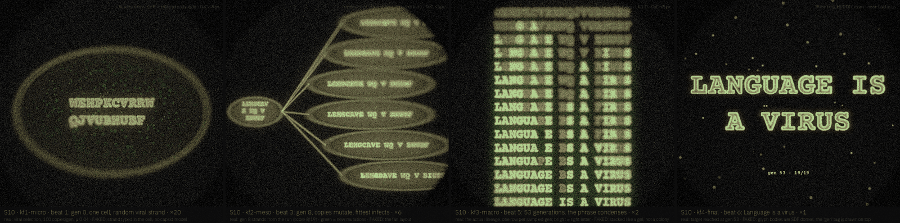
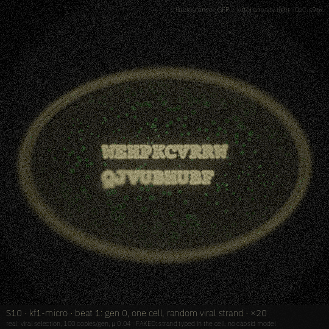
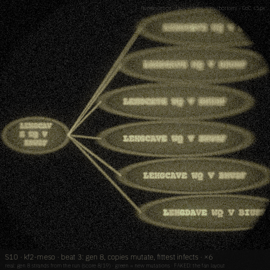
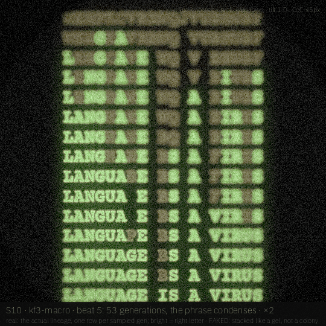
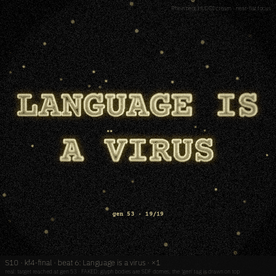

# S10 · *Language is a virus*

William S. Burroughs' line staged as viral replication and cumulative selection in a host lineage: each cell carries a 19-character viral strand typed in Courier Prime, every generation 100 copies mutate, the highest-affinity copy infects the next, and the phrase condenses out of noise.

| | |
|---|---|
| **Phrase** | LANGUAGE IS A VIRUS (William S. Burroughs, *The Ticket That Exploded*) |
| **System** | viral replication + cumulative selection: 100 copies per generation, per-letter mutation μ 0.04 over 27 symbols, keep the fittest; seed 1986 converges at **generation 53** |
| **Look chain** | fluorescence (GFP = letter already right) → fluorescence → fluorescence → Rheinberg HUDDI cream |
| **Font** | **Courier Prime Bold** (OFL 1.1; monospace cut-up typewriter face, so every genome position is a fixed column and the alignment in beat 5 reads straight down) · proposed, **not claimed** (not in `visuals/maker/used-words-fonts.md` as of 19 Oct 2026; claim it in the registry only if AJ approves the board) |
| **Legibility** | literally the viral fitness score: matched letters / 19 (0.05 at gen 0 → 1.0 at gen 53) |
| **Proposed clip** | 12 s · 24 fps · 1080² · one generation every ~5 frames for the middle section |

## Beats

| # | u (0–1) | scale | camera / focus | what happens | look |
|---|---|---|---|---|---|
| 1 | 0.00–0.12 | ×20 | on one host cell, rack to the nucleus | generation 0: one cell, a random 19-letter viral strand; the odd matched base glows green | fluorescence |
| 2 | 0.12–0.25 | ×20→×6 | pull back as copies lyse and fan out | the strand replicates into 100 daughter copies; each carries new point mutations (green) | fluorescence |
| 3 | 0.25–0.40 | ×6 | rack down the fan to the fittest copy | selection: the highest-scoring copy is in focus, the rest fall out of focus and fade | fluorescence |
| 4 | 0.40–0.55 | ×6→×2 | pull back and up | generations stack, one row per generation, like a sequencing gel | fluorescence |
| 5 | 0.55–0.80 | ×2 | tilt 1.0, focus slides down to the late rows | the phrase condenses down the columns: letters lock in and stay | fluorescence |
| 6 | 0.80–1.00 | ×1 | near-flat focus | the converged phrase as stained cell bodies, tagged *gen 53 · 19/19* | Rheinberg HUDDI cream |

## Keyframes (540², local drafts)

| file | beat | what you see |
|---|---|---|
| [`kf1-micro.png`](storyboards/S10/kf1-micro.png) | 1 | gen 0 viral strand in one cell, matched letter in green |
| [`kf2-meso.png`](storyboards/S10/kf2-meso.png) | 3 | gen 8 parent → 6 of its copies, fittest at the bottom in focus, new mutations green |
| [`kf3-macro.png`](storyboards/S10/kf3-macro.png) | 5 | the real lineage gen 0 → 53 as 15 sampled rows; right letters bright |
| [`kf4-final.png`](storyboards/S10/kf4-final.png) | 6 | converged phrase LANGUAGE IS / A VIRUS, glyph bodies as SDF domes, gen tag |

|  |  |
|---|---|
| **`kf1-micro`** (beat 1) — gen 0 viral strand in one cell, matched letter in green | **`kf2-meso`** (beat 3) — gen 8 parent → 6 of its copies, fittest at the bottom in focus, new mutations green |
|  |  |
| **`kf3-macro`** (beat 5) — the real lineage gen 0 → 53 as 15 sampled rows; right letters bright | **`kf4-final`** (beat 6) — converged phrase LANGUAGE IS / A VIRUS, glyph bodies as SDF domes, gen tag |

## Real vs faked

**Real (simulated or computed):**

- the viral selection run itself (exact, deterministic with seed 1986): every string shown is a genome from the run
- fitness, mutation positions and the generation count (53)
- glab fluorescence / Rheinberg optics + ring-blur CoC

**Faked or shortcut in these drafts:**

- the cells, nucleus and fan layout are drawn; there is no capsid sim or DNA model, and the text is typed into the cell
- kf3 *stacks generations like a gel*: a diagram, not a colony
- kf4 glyph bodies are SDF domes and the gen tag is drawn on top

## Port notes [proposal]

- the selection loop is CPU-trivial; the engine only needs a text layer per cell and a per-letter emissive accent (`A` channel)
- could ride on the existing cell/mitosis look (V4 *SPLIT*) for the replication fan in beat 2
- hero knobs: `mu`, `offspring`, `seed`; the arc is the fitness curve, so it cannot be keyed directly

## Open questions / risks

- cumulative selection toward a fixed target is diagrammatic by nature; the board leans into that honesty, though AJ may want more organic capsid/lysis geometry in beats 1–2.

## Source

- Render: `docs-src/storyboards/_src/s10.py` (imports `_src/sbkit.py`, which drives the glab looks in `visuals/glab/src/looks.py` and `darkfield_huddi.py` at 540²).
- Every keyframe carries its own label strip: board · keyframe · beat · scale on line 1, what is real vs faked on line 2, look + focus top right.
