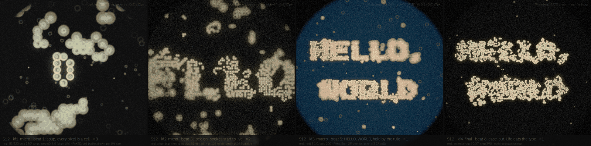
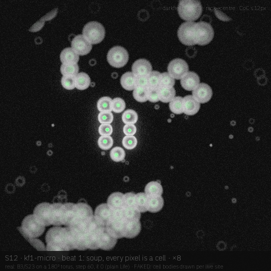
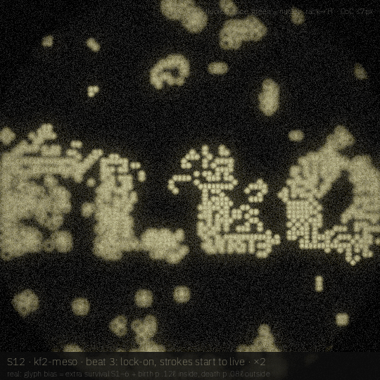
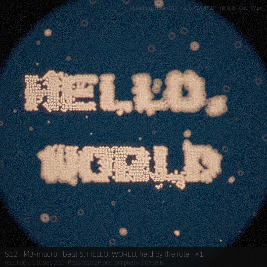
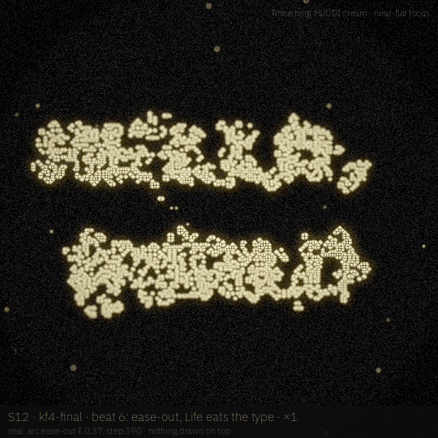

# S12 · *Hello, world*

The canonical first program born out of Conway's Life where every live pixel is a living cell: a plain soup, then the glyph bias switches on with the legibility arc and the rule boots HELLO, WORLD, then lets go and Life eats the type back.

| | |
|---|---|
| **Phrase** | HELLO, / WORLD |
| **System** | Conway B3/S23 on a 180² torus (random 33 % soup, seed 1970) + glyph bias gated by ℓ: inside the glyph extra survival S1–6 and birth p 0.12ℓ, outside extra death p 0.08ℓ; ℓ = 0 is plain Life |
| **Look chain** | darkfield HUDDI → fluorescence → Rheinberg (look-01) → Rheinberg HUDDI cream |
| **Font** | **Press Start 2P** (OFL 1.1; an 8×8 pixel font, so one font pixel = 3 CA cells and the type sits on the Life lattice) · proposed, **not claimed** (not in `visuals/maker/used-words-fonts.md` as of 19 Oct 2026; claim it in the registry only if AJ approves the board) |
| **Legibility** | an arc variant: 0 for the soup (not 0.2, so the opening is pure Conway), lock-on 0.30–0.40, hold 1.0, ease-out to 0.35 (the default ease-out) |
| **Proposed clip** | 10 s · 24 fps · 1080² · 400 generations, 1 generation per 0.6 frame |

## Beats

| # | u (0–1) | scale | camera / focus | what happens | look |
|---|---|---|---|---|---|
| 1 | 0.00–0.15 | ×8 | on a corner of the soup, rack to centre | plain Life soup: blocks, blinkers, debris, each live site drawn as a cell with a nucleus | darkfield HUDDI |
| 2 | 0.15–0.30 | ×8→×2 | pull back | the soup burns down toward ash (still lifes + oscillators) | darkfield → fluorescence |
| 3 | 0.30–0.40 | ×2 | rack to the H | lock-on: the glyph bias switches on and strokes start to live | fluorescence |
| 4 | 0.40–0.55 | ×2→×1 | pull out to the whole dish | outside the letters the soup dies off, the strokes fill | fluorescence → Rheinberg |
| 5 | 0.55–0.75 | ×1 | tilt 0.8, rack to WORLD | hold: HELLO, WORLD held by the modified rule, still flickering at the edges | Rheinberg |
| 6 | 0.75–1.00 | ×1 | near-flat focus | ease-out: ℓ falls to 0.37, plain Life wins back and eats the type | Rheinberg HUDDI cream |

## Keyframes (540², local drafts)

| file | beat | what you see |
|---|---|---|
| [`kf1-micro.png`](storyboards/S12/kf1-micro.png) | 1 | step 60, ×8, plain Life structures as cells |
| [`kf2-meso.png`](storyboards/S12/kf2-meso.png) | 3 | step 150, lock-on (ℓ 0.84): first strokes of HELLO alive, green nuclei |
| [`kf3-macro.png`](storyboards/S12/kf3-macro.png) | 5 | step 200, hold: HELLO, WORLD |
| [`kf4-final.png`](storyboards/S12/kf4-final.png) | 6 | step 390, ease-out (ℓ 0.37): the type erodes |

|  |  |
|---|---|
| **`kf1-micro`** (beat 1) — step 60, ×8, plain Life structures as cells | **`kf2-meso`** (beat 3) — step 150, lock-on (ℓ 0.84): first strokes of HELLO alive, green nuclei |
|  |  |
| **`kf3-macro`** (beat 5) — step 200, hold: HELLO, WORLD | **`kf4-final`** (beat 6) — step 390, ease-out (ℓ 0.37): the type erodes |

## Real vs faked

**Real (simulated or computed):**

- Conway B3/S23 exactly when ℓ = 0; the glyph bias rules above when ℓ > 0
- the arc schedule (`legibility_at`-style, starting at 0)
- glab optics + ring-blur CoC

**Faked or shortcut in these drafts:**

- cell bodies per live site are drawn (packed Voronoi-of-circles domes with a nucleus), not simulated
- spontaneous birth inside the glyph is a stochastic cheat that a purist would not call Life; it is the C4 *kernel panic* idea (letter bias gated by the arc) made explicit

## Port notes [proposal]

- Life is the cheapest kernel in the set: one 3×3 count per cell, bit-packed on Metal; the bias needs the glyph mask at CA resolution only
- one font pixel = N CA cells is a GlyphSource layout option (snap to lattice)
- shares the arc gating with C4 *kernel panic*; could be the same kernel with a different render

## Open questions / risks

- close cousin of C4 *kernel panic* (Life-CA letter bias, VT323); S12 differs by the pixel font on the lattice and by the biological cell rendering, but AJ should see them side by side
- kf4 is an erosion frame on purpose; if the board needs to end readable, move the hold to the last beat and the ease-out to a coda.

## Source

- Render: `docs-src/storyboards/_src/s12.py` (imports `_src/sbkit.py`, which drives the glab looks in `visuals/glab/src/looks.py` and `darkfield_huddi.py` at 540²).
- Sim: `docs-src/storyboards/_src/s12_sim.py`, cache in `/tmp/sb_s12/` (box-local, not committed). Run the sim first, then the render: `nice -n 10 python3 s12_sim.py && nice -n 10 python3 s12.py`.
- Every keyframe carries its own label strip: board · keyframe · beat · scale on line 1, what is real vs faked on line 2, look + focus top right.
